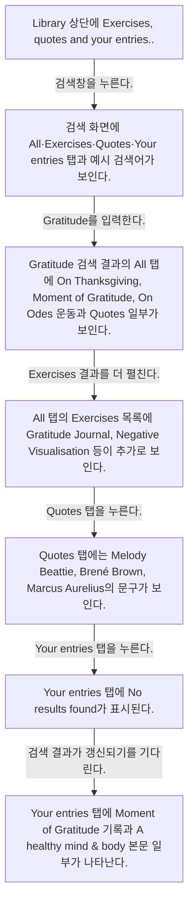
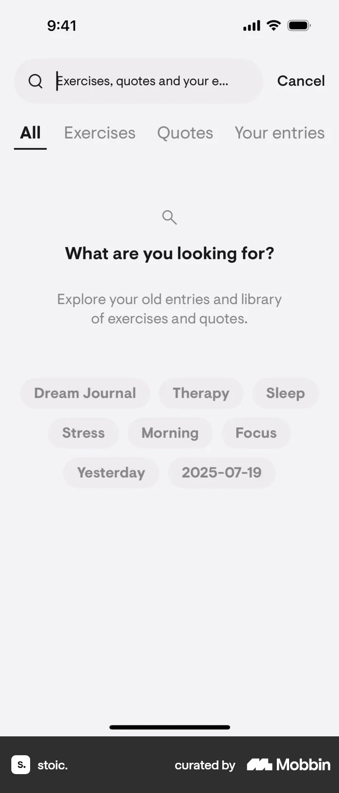
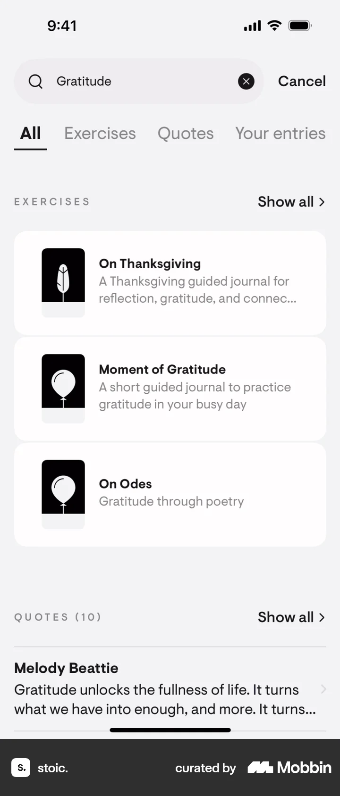
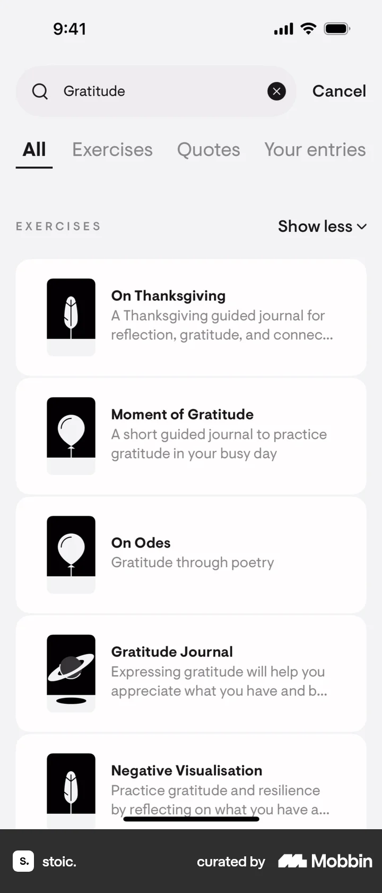
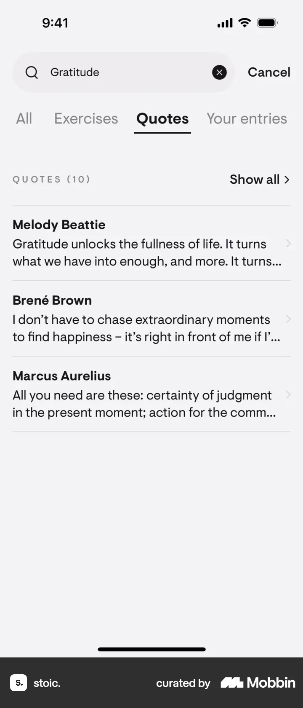
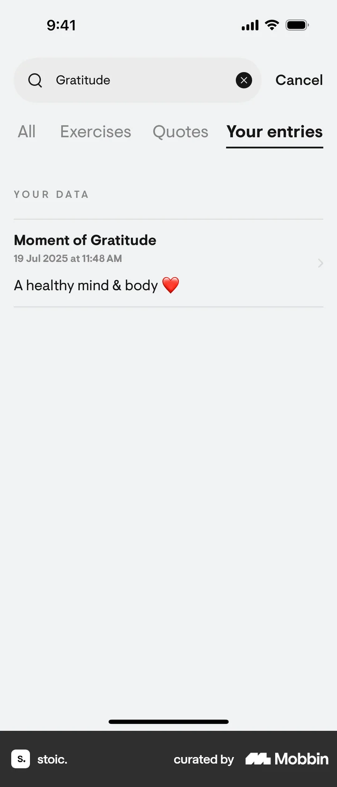

# Searching stoic. from Library

- Mobbin 상세 페이지: https://mobbin.com/flows/d38a549c-e655-44c0-a725-de9519ee141f?tab=screens
- 앱·기기: stoic. iOS, 393×852
- 화면 수: 상세 페이지 7장 / 저장 이미지 7장 / 아래 설명 7개
- 검증 상태: **verified** — 목록 제목·상세 제목·URL과 화면별 이미지 수·순서·상태 변화를 대조했다.

## 화면별 기록

1.  Library 상단에 `Exercises, quotes and your entries...` 검색창과 추천 카드가 보인다. 검색창을 누른다. 다음 화면에서는 검색 화면에 All·Exercises·Quotes·Your entries 탭과 예시 검색어가 보인다.
2.  검색 화면에 All·Exercises·Quotes·Your entries 탭과 예시 검색어가 보인다. `Gratitude`를 입력한다. 다음 화면에서는 Gratitude 검색 결과의 All 탭에 On Thanksgiving, Moment of Gratitude, On Odes 운동과 Quotes 일부가 보인다.
3.  Gratitude 검색 결과의 All 탭에 On Thanksgiving, Moment of Gratitude, On Odes 운동과 Quotes 일부가 보인다. Exercises 결과를 더 펼친다. 다음 화면에서는 All 탭의 Exercises 목록에 Gratitude Journal, Negative Visualisation 등이 추가로 보인다.
4.  All 탭의 Exercises 목록에 Gratitude Journal, Negative Visualisation 등이 추가로 보인다. `Quotes` 탭을 누른다. 다음 화면에서는 Quotes 탭에는 Melody Beattie, Brené Brown, Marcus Aurelius의 문구가 보인다.
5.  Quotes 탭에는 Melody Beattie, Brené Brown, Marcus Aurelius의 문구가 보인다. `Your entries` 탭을 누른다. 다음 화면에서는 Your entries 탭에 `No results found`가 표시된다.
6.  Your entries 탭에 `No results found`가 표시된다. 검색 결과가 갱신되기를 기다린다. 다음 화면에서는 Your entries 탭에 `Moment of Gratitude` 기록과 `A healthy mind & body` 본문 일부가 나타난다.
7.  Your entries 탭에 `Moment of Gratitude` 기록과 `A healthy mind & body` 본문 일부가 나타난다.

## BMad handoff notes

- **관찰된 진입 상태:** Library의 검색창이 보인다.
- **주요 행동:** Gratitude를 검색하고 All·Quotes·Your entries 결과를 탐색한다.
- **기대 결과:** 운동·명언·개인 기록이 범주별로 나타난다. 일시적으로 No results found가 보인 뒤 기록 결과가 로드된다.
- **되돌릴 수 있거나 파괴적인 동작:** 검색어를 지우거나 Cancel로 돌아갈 수 있다. 삭제 동작은 없다.
