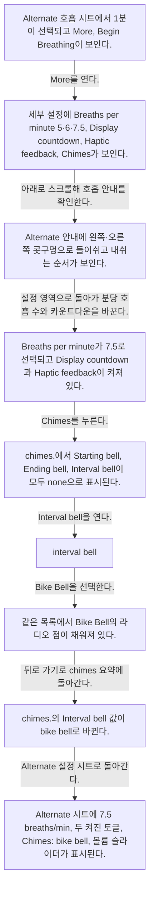
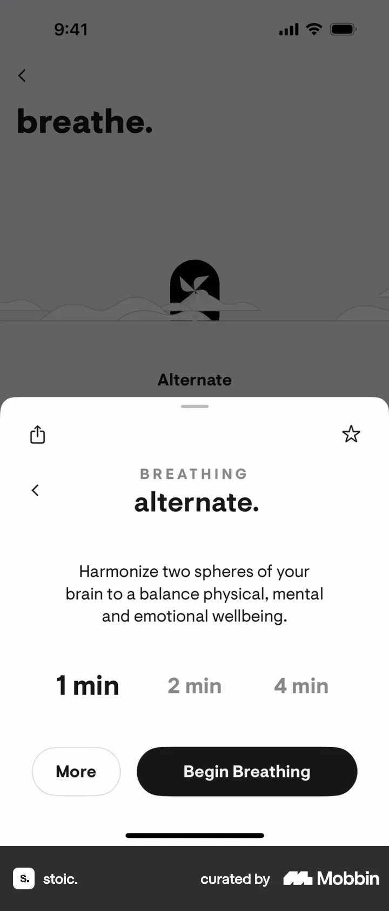
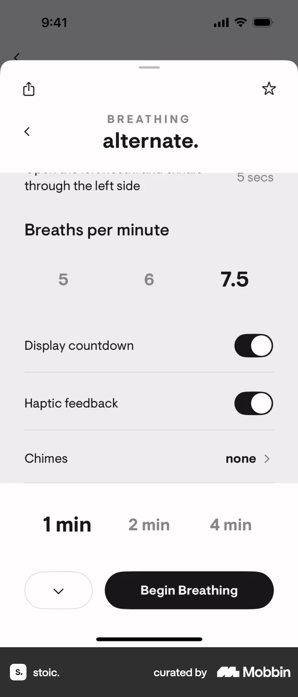
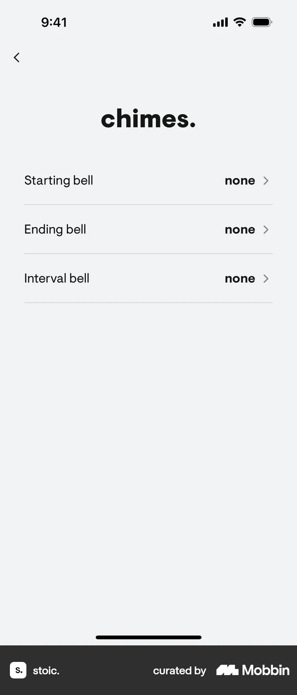
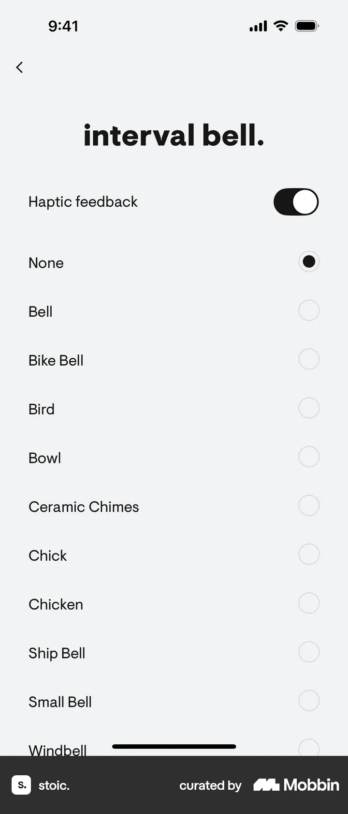
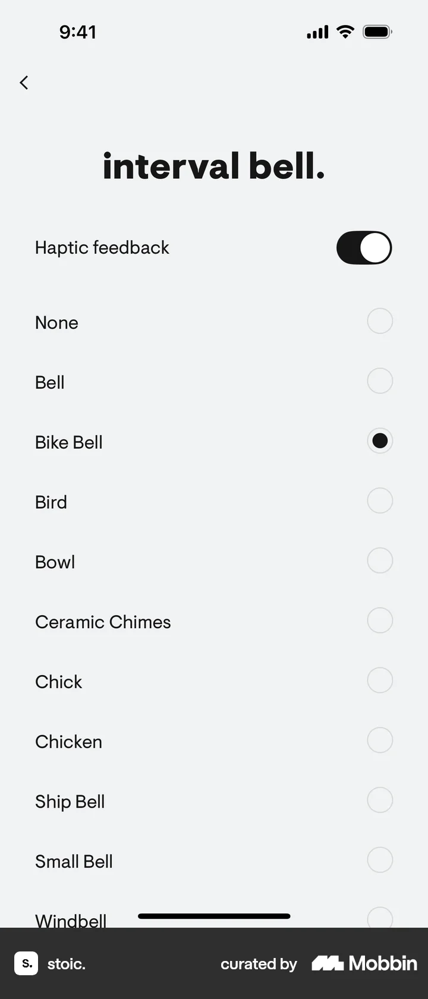

# Setting up exercise preferences  from Completing an exercise (breathing)

- Mobbin 상세 페이지: https://mobbin.com/flows/fc324f7f-bf3c-48a2-9c3e-b41d8639e11e?tab=screens
- 앱·기기: stoic. iOS, 393×852
- 화면 수: 상세 페이지 9장 / 저장 이미지 9장 / 아래 설명 9개
- 검증 상태: **verified** — 목록 제목·상세 제목·URL과 화면별 이미지 수·순서·상태 변화를 대조했다.

## 화면별 기록

1.  Alternate 호흡 시트에서 1분이 선택되고 `More`, `Begin Breathing`이 보인다. `More`를 연다. 다음 화면에서는 세부 설정에 `Breaths per minute` 5·6·7.5, `Display countdown`, `Haptic feedback`, `Chimes`가 보인다.
2.  세부 설정에 `Breaths per minute` 5·6·7.5, `Display countdown`, `Haptic feedback`, `Chimes`가 보인다. 아래로 스크롤해 호흡 안내를 확인한다. 다음 화면에서는 Alternate 안내에 왼쪽·오른쪽 콧구멍으로 들이쉬고 내쉬는 순서가 보인다.
3.  Alternate 안내에 왼쪽·오른쪽 콧구멍으로 들이쉬고 내쉬는 순서가 보인다. 설정 영역으로 돌아가 분당 호흡 수와 카운트다운을 바꾼다. 다음 화면에서는 `Breaths per minute`가 7.5로 선택되고 `Display countdown`과 `Haptic feedback`이 켜져 있다.
4.  `Breaths per minute`가 7.5로 선택되고 `Display countdown`과 `Haptic feedback`이 켜져 있다. `Chimes`를 누른다. 다음 화면에서는 `chimes.`에서 Starting bell, Ending bell, Interval bell이 모두 none으로 표시된다.
5.  `chimes.`에서 Starting bell, Ending bell, Interval bell이 모두 none으로 표시된다. `Interval bell`을 연다. 다음 화면에서는 `interval bell.` 목록에 None, Bell, Bike Bell, Bird 등이 있고 None이 선택돼 있다.
6.  `interval bell.` 목록에 None, Bell, Bike Bell, Bird 등이 있고 None이 선택돼 있다. `Bike Bell`을 선택한다. 다음 화면에서는 같은 목록에서 `Bike Bell`의 라디오 점이 채워져 있다.
7.  같은 목록에서 `Bike Bell`의 라디오 점이 채워져 있다. 뒤로 가기로 chimes 요약에 돌아간다. 다음 화면에서는 `chimes.`의 Interval bell 값이 `bike bell`로 바뀐다.
8.  `chimes.`의 Interval bell 값이 `bike bell`로 바뀐다. Alternate 설정 시트로 돌아간다. 다음 화면에서는 Alternate 시트에 7.5 breaths/min, 두 켜진 토글, `Chimes: bike bell`, 볼륨 슬라이더가 표시된다.
9.  Alternate 시트에 7.5 breaths/min, 두 켜진 토글, `Chimes: bike bell`, 볼륨 슬라이더가 표시된다.

## BMad handoff notes

- **관찰된 진입 상태:** Alternate 호흡 운동의 설정 시트.
- **주요 행동:** More에서 분당 호흡 수, 카운트다운·진동, interval bell을 설정한다.
- **기대 결과:** 7.5 breaths/min과 bike bell이 요약에 반영된다. 실제 운동 실행은 이 플로우에서 확인 불가.
- **되돌릴 수 있거나 파괴적인 동작:** 값과 토글을 다시 선택해 수정할 수 있다. 삭제 동작은 없다.
