# Setting up stoic shield from Profile

- Mobbin 상세 페이지: https://mobbin.com/flows/09a3ce57-5fd1-4bda-aa81-89e354652925?tab=screens
- 앱·기기: stoic. iOS, 393×852
- 화면 수: 상세 페이지 14장 / 저장 이미지 14장 / 아래 설명 14개
- 검증 상태: **verified** — iOS Screen Time 권한창에서 Continue, Evening 설정에서 Don't block apps in the Evening을 누른 동작을 사용자에게 확인했다. Morning 1 item blocked와 Evening 꺼짐까지 이미지 순서대로 확인했다. 실제 시스템 차단 발생은 캡처 범위 밖이다.

```mermaid
flowchart TD
  S1["Profile PERSONALIZE 목록에 Stoic Shield가 보인다."]
  S1 -->|Stoic Shield를 누른다.| S2
  S2["휴대폰을 유익하게 쓰자는 소개와 Next가 보인다."]
  S2 -->|Next를 누른다.| S3
  S3["방해 앱을 열 때 mindful reminder를 보여 주며 Screen Time 권한이 필요하다는 안내가 보인다."]
  S3 -->|Next를 누른다.| S4
  S4["iOS의 Would Like to Access Screen Time 권한창에 Continue와 Don't Allow가 보인다."]
  S4 -->|Continue를 누른다.| S5
  S5["Now let's set up your schedule"]
  S5 -->|Next를 누른다.| S6
  S6["Morning 설정에서 차단 앱 선택과 Don't block apps in the Morning이 보인다."]
  S6 -->|Select apps to limit in the Morning을 누른다.| S7
  S7["iOS Choose Activities 목록에 Social·Games 등 범주가 보인다."]
  S7 -->|Social을 선택한다.| S8
  S8["Social에 파란 체크가 생기고 오른쪽 위 Done이 보인다."]
  S8 -->|Done을 누른다.| S9
  S9["Morning 설정에 1 item blocked, From 5:00 AM, To Morning Preparation, 전 요일이 보인다."]
  S9 -->|Next를 누른다.| S10
  S10["Evenings 설정에 차단 앱 선택과 Don't block apps in the Evening이 보인다."]
  S10 -->|Don't block apps in the Evening을 누른다.| S11
  S11["Good job! 안내에 이후 사용자 지정 스케줄을 만들 수 있다고 적혀 있다."]
  S11 -->|Next를 누른다.| S12
  S12["You're all set!과 Yay!가 보인다."]
  S12 -->|Yay!를 누른다.| S13
  S13["stoic shield.에서 Morning 차단 1개가 켜지고 Evening 차단은 꺼져 있다."]
  S13 -->|아래로 스크롤한다.| S14
  S14["하단에 Evening 차단 설정과 + Add more schedules가 보인다."]
```

## 화면별 기록

1. 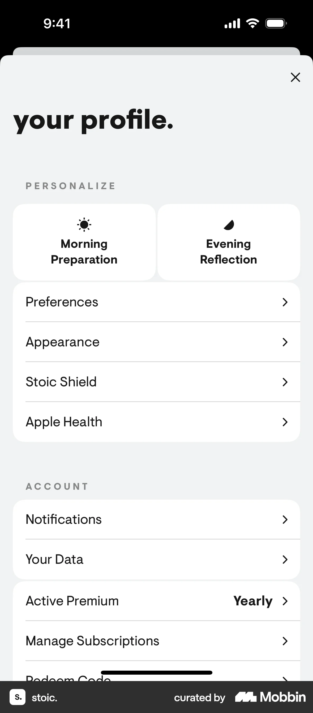 Profile PERSONALIZE 목록에 `Stoic Shield`가 보인다. `Stoic Shield`를 누른다. 다음 화면에서는 휴대폰을 유익하게 쓰자는 소개와 `Next`가 보인다.
2. 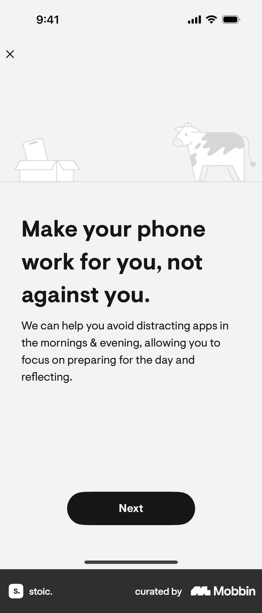 휴대폰을 유익하게 쓰자는 소개와 `Next`가 보인다. `Next`를 누른다. 다음 화면에서는 방해 앱을 열 때 mindful reminder를 보여 주며 Screen Time 권한이 필요하다는 안내가 보인다.
3. 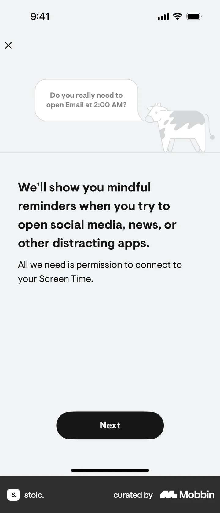 방해 앱을 열 때 mindful reminder를 보여 주며 Screen Time 권한이 필요하다는 안내가 보인다. `Next`를 누른다. 다음 화면에서는 iOS의 `Would Like to Access Screen Time` 권한창에 Continue와 Don't Allow가 보인다.
4. 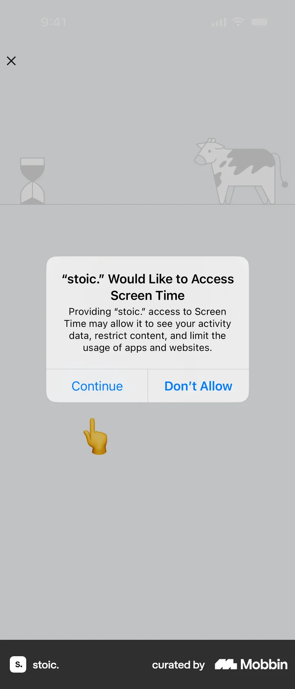 iOS의 `Would Like to Access Screen Time` 권한창에 Continue와 Don't Allow가 보인다. `Continue`를 누른다(사용자 확인). 다음 화면에서는 `Now let's set up your schedule.` 안내가 보인다. 실제 iOS 권한 적용 상태는 화면에서 확인 불가.
5. 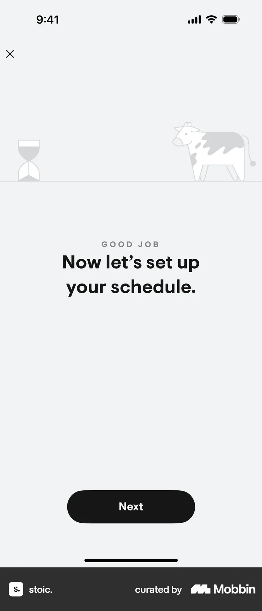 `Now let's set up your schedule.` 안내가 보인다. `Next`를 누른다. 다음 화면에서는 Morning 설정에서 차단 앱 선택과 `Don't block apps in the Morning`이 보인다.
6. 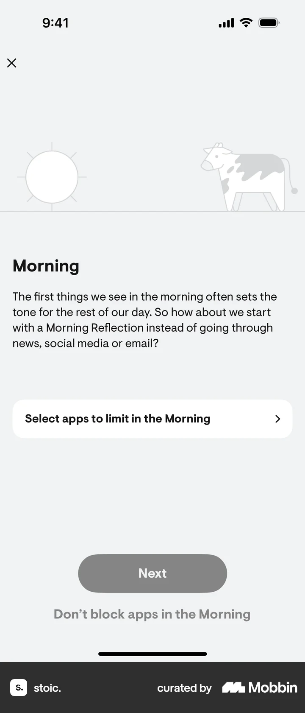 Morning 설정에서 차단 앱 선택과 `Don't block apps in the Morning`이 보인다. `Select apps to limit in the Morning`을 누른다. 다음 화면에서는 iOS Choose Activities 목록에 Social·Games 등 범주가 보인다.
7. 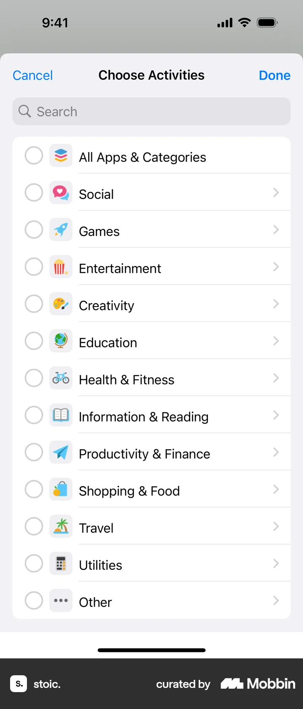 iOS Choose Activities 목록에 Social·Games 등 범주가 보인다. `Social`을 선택한다. 다음 화면에서는 Social에 파란 체크가 생기고 오른쪽 위 Done이 보인다.
8. 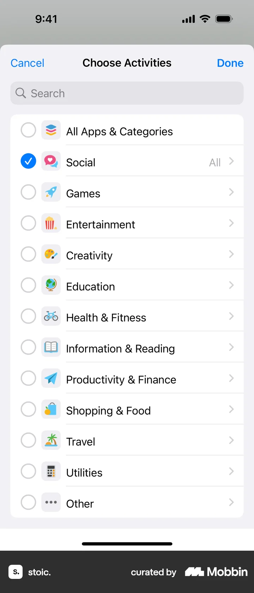 Social에 파란 체크가 생기고 오른쪽 위 Done이 보인다. `Done`을 누른다. 다음 화면에서는 Morning 설정에 `1 item blocked`, From 5:00 AM, To Morning Preparation, 전 요일이 보인다.
9. 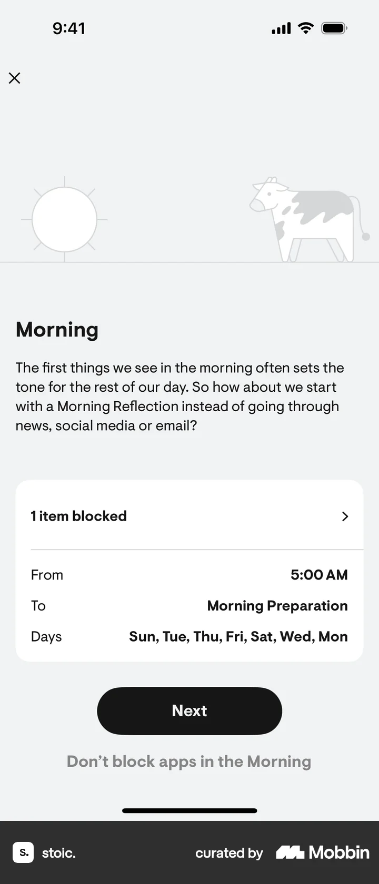 Morning 설정에 `1 item blocked`, From 5:00 AM, To Morning Preparation, 전 요일이 보인다. `Next`를 누른다. 다음 화면에서는 Evenings 설정에 차단 앱 선택과 `Don't block apps in the Evening`이 보인다.
10. 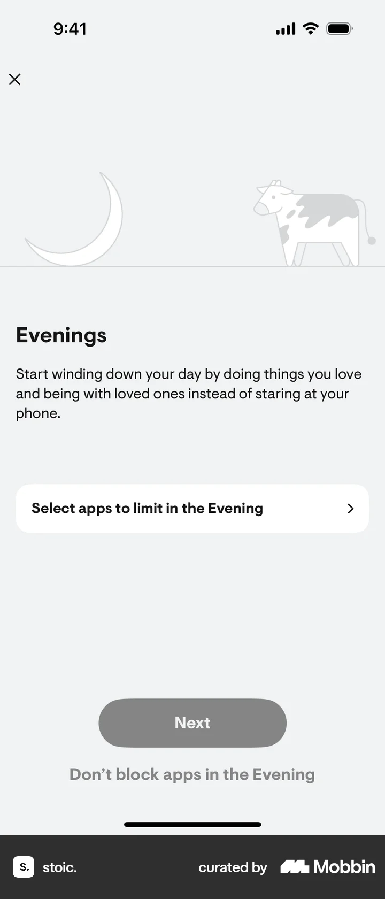 Evenings 설정에 차단 앱 선택과 `Don't block apps in the Evening`이 보인다. `Don't block apps in the Evening`을 누른다(사용자 확인). 다음 화면에서는 `Good job!` 안내에 이후 사용자 지정 스케줄을 만들 수 있다고 적혀 있다.
11. 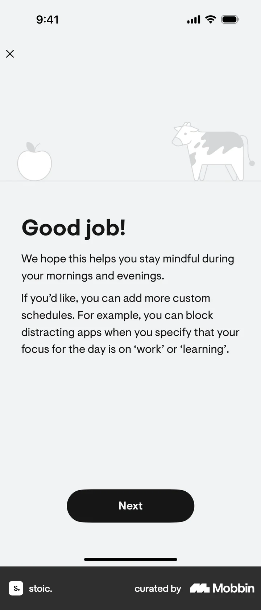 `Good job!` 안내에 이후 사용자 지정 스케줄을 만들 수 있다고 적혀 있다. `Next`를 누른다. 다음 화면에서는 `You're all set!`과 Yay!가 보인다.
12. 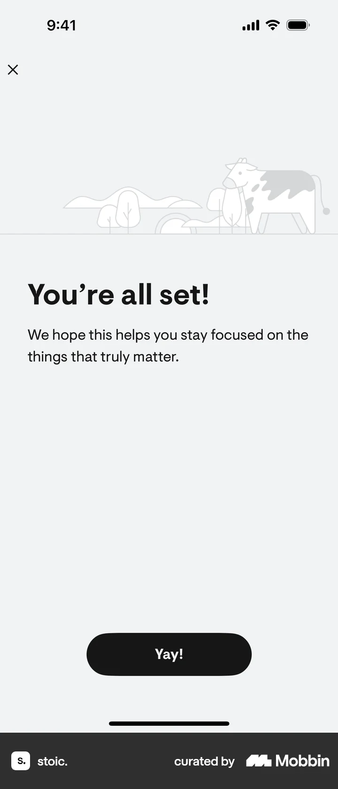 `You're all set!`과 Yay!가 보인다. `Yay!`를 누른다. 다음 화면에서는 stoic shield.에서 Morning 차단 1개가 켜지고 Evening 차단은 꺼져 있다.
13.  stoic shield.에서 Morning 차단 1개가 켜지고 Evening 차단은 꺼져 있다. 아래로 스크롤한다. 다음 화면에서는 하단에 Evening 차단 설정과 `+ Add more schedules`가 보인다.
14. 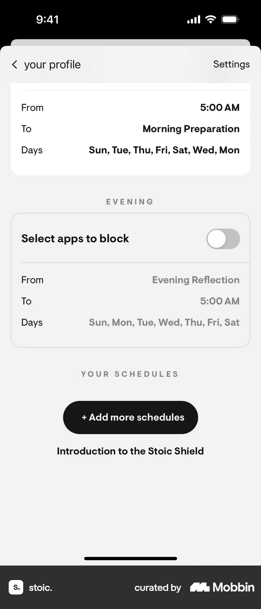 하단에 Evening 차단 설정과 `+ Add more schedules`가 보인다.

## BMad handoff notes

- **관찰된 진입 상태:** Profile의 Stoic Shield 항목.
- **주요 행동:** Screen Time 권한을 진행하고 Morning에 Social 범주를 차단한 뒤 Evening은 차단하지 않고 설정을 마친다.
- **기대 결과:** Stoic Shield에 Morning 1 item blocked 켜짐, Evening 꺼짐이 표시된다. 실제 시스템 차단 발생은 화면에서 확인 불가.
- **되돌릴 수 있거나 파괴적인 동작:** Morning·Evening 토글과 일정 설정이 보인다. 차단 해제 결과는 이 플로우에서 확인 불가.
