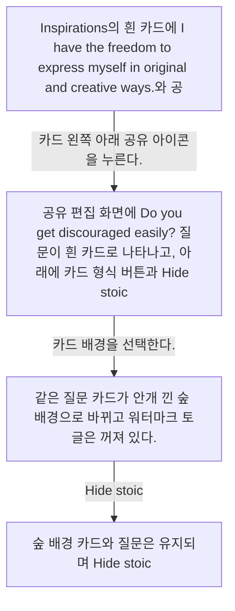
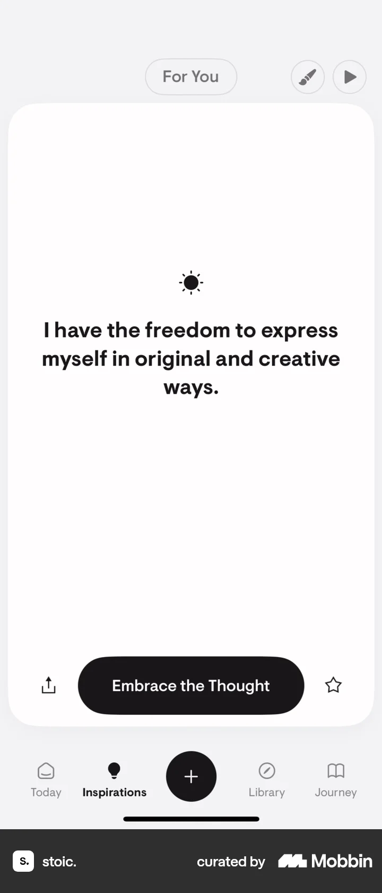
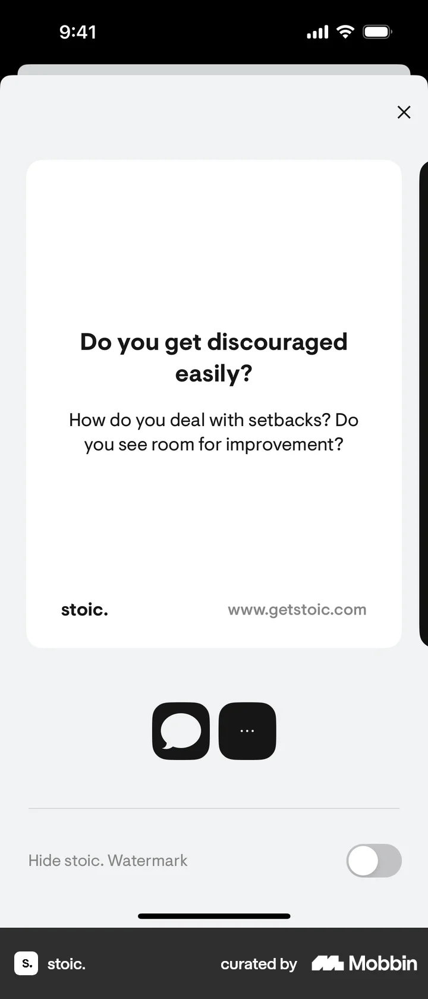
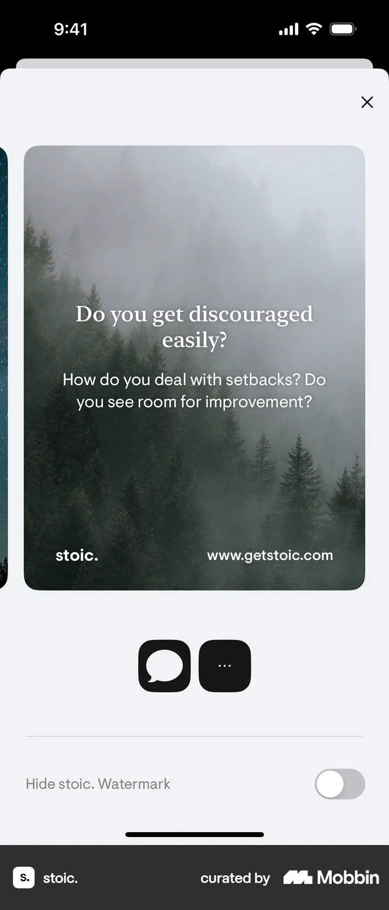
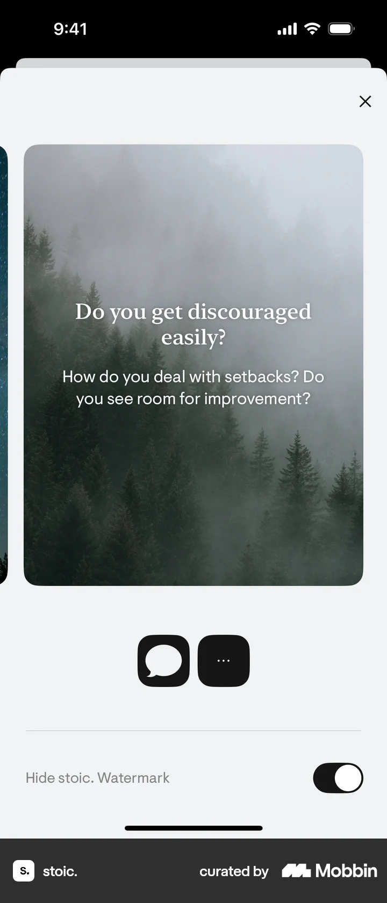

# Share a prompt from Inspirations

- Mobbin 상세 페이지: https://mobbin.com/flows/5bc98113-cca8-4672-b958-70882f6bd939?tab=screens
- 앱·기기: stoic. iOS, 393×852
- 화면 수: 상세 페이지 4장 / 저장 이미지 4장 / 아래 설명 4개
- 검증 상태: **verified** — 목록 제목·상세 제목·URL과 화면별 이미지 수·순서·상태 변화를 대조했다.

## 화면별 기록

1.  Inspirations의 흰 카드에 `I have the freedom to express myself in original and creative ways.`와 공유·별표 아이콘이 보인다. 카드 왼쪽 아래 공유 아이콘을 누른다. 다음 화면에서는 공유 편집 화면에 `Do you get discouraged easily?` 질문이 흰 카드로 나타나고, 아래에 카드 형식 버튼과 `Hide stoic. Watermark` 토글이 있다.
2.  공유 편집 화면에 `Do you get discouraged easily?` 질문이 흰 카드로 나타나고, 아래에 카드 형식 버튼과 `Hide stoic. Watermark` 토글이 있다. 카드 배경을 선택한다. 다음 화면에서는 같은 질문 카드가 안개 낀 숲 배경으로 바뀌고 워터마크 토글은 꺼져 있다.
3.  같은 질문 카드가 안개 낀 숲 배경으로 바뀌고 워터마크 토글은 꺼져 있다. `Hide stoic. Watermark`를 켠다. 다음 화면에서는 숲 배경 카드와 질문은 유지되며 `Hide stoic. Watermark` 스위치가 검은 켜짐 상태가 된다. 실제 공유 완료 화면은 없다.
4.  숲 배경 카드와 질문은 유지되며 `Hide stoic. Watermark` 스위치가 검은 켜짐 상태가 된다. 실제 공유 완료 화면은 없다.

## BMad handoff notes

- **관찰된 진입 상태:** Inspirations의 문구 카드에서 공유 아이콘을 사용할 수 있는 상태.
- **주요 행동:** 공유 편집기를 열고 배경을 선택한 뒤 워터마크 숨기기 토글을 켠다.
- **기대 결과:** 숲 배경의 공유 카드 미리보기와 워터마크 숨김 설정이 보인다. 외부 전송 결과는 화면에서 확인 불가.
- **되돌릴 수 있거나 파괴적인 동작:** 배경과 워터마크 토글은 다시 바꿀 수 있다. 삭제 동작은 없다.
