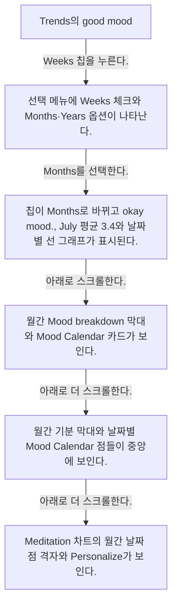
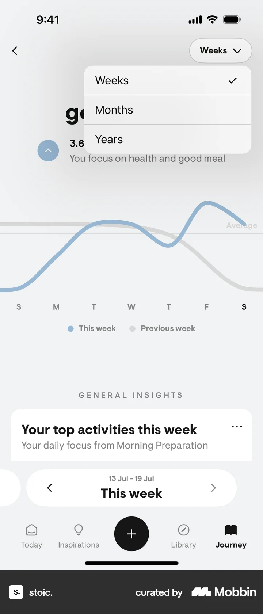
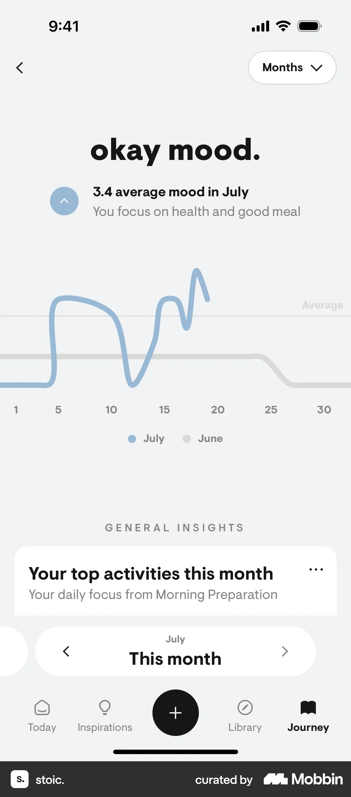
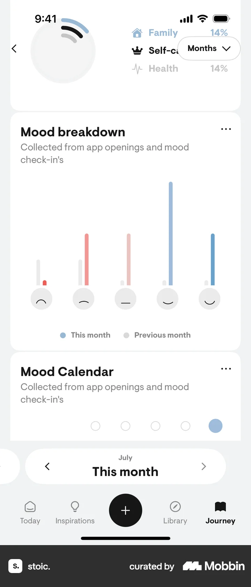
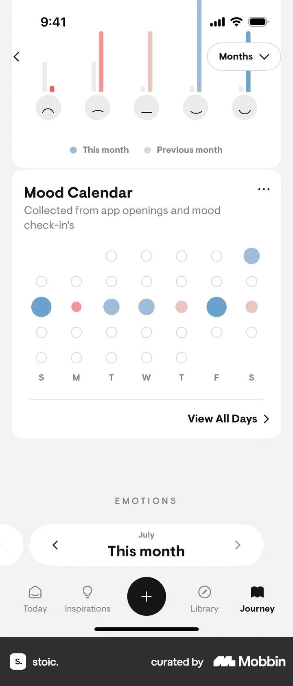
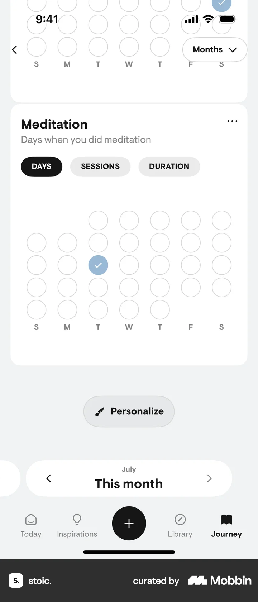

# Sorting by months from Trends & insights

- Mobbin 상세 페이지: https://mobbin.com/flows/a1411599-418b-4bc3-ba75-6bc9e3aab578?tab=screens
- 앱·기기: stoic. iOS, 393×852
- 화면 수: 상세 페이지 6장 / 저장 이미지 6장 / 아래 설명 6개
- 검증 상태: **verified** — 목록 제목·상세 제목·URL과 화면별 이미지 수·순서·상태 변화를 대조했다.

## 화면별 기록

1.  Trends의 `good mood.` 주간 선 그래프와 `Weeks` 선택 칩이 보인다. `Weeks` 칩을 누른다. 다음 화면에서는 선택 메뉴에 Weeks 체크와 Months·Years 옵션이 나타난다.
2.  선택 메뉴에 Weeks 체크와 Months·Years 옵션이 나타난다. `Months`를 선택한다. 다음 화면에서는 칩이 `Months`로 바뀌고 `okay mood.`, July 평균 3.4와 날짜별 선 그래프가 표시된다.
3.  칩이 `Months`로 바뀌고 `okay mood.`, July 평균 3.4와 날짜별 선 그래프가 표시된다. 아래로 스크롤한다. 다음 화면에서는 월간 Mood breakdown 막대와 Mood Calendar 카드가 보인다.
4.  월간 Mood breakdown 막대와 Mood Calendar 카드가 보인다. 아래로 더 스크롤한다. 다음 화면에서는 월간 기분 막대와 날짜별 Mood Calendar 점들이 중앙에 보인다.
5.  월간 기분 막대와 날짜별 Mood Calendar 점들이 중앙에 보인다. 아래로 더 스크롤한다. 다음 화면에서는 Meditation 차트의 월간 날짜 점 격자와 `Personalize`가 보인다.
6.  Meditation 차트의 월간 날짜 점 격자와 `Personalize`가 보인다.

## BMad handoff notes

- **관찰된 진입 상태:** Trends 기간 선택이 Weeks다.
- **주요 행동:** 기간을 Months로 바꾸고 월간 차트들을 스크롤한다.
- **기대 결과:** July 평균과 월간 기분·캘린더·명상 차트가 표시된다.
- **되돌릴 수 있거나 파괴적인 동작:** 기간 메뉴에서 Weeks나 Years로 다시 바꿀 수 있다. 삭제 동작은 없다.
