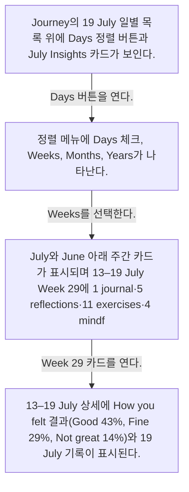
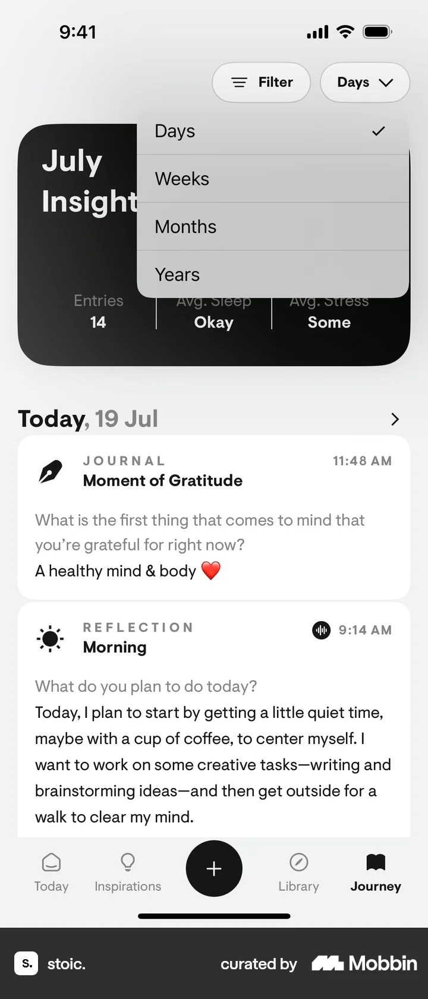
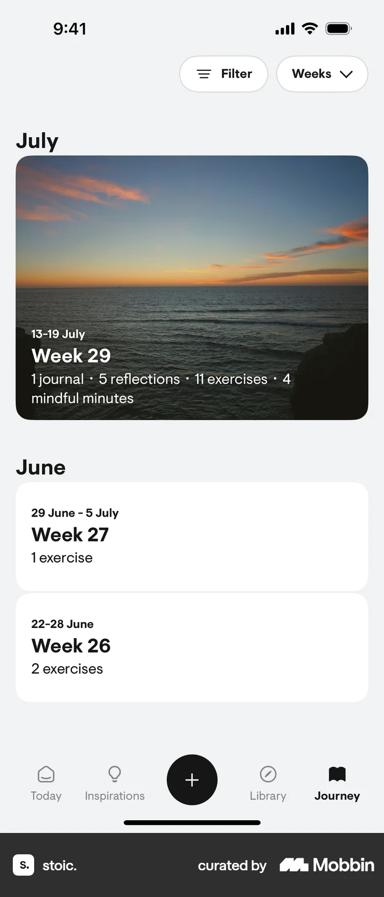

# Sorting entries from Journey

- Mobbin 상세 페이지: https://mobbin.com/flows/a3ff7803-dd59-45f7-a2e0-0268ab305a1b?tab=screens
- 앱·기기: stoic. iOS, 393×852
- 화면 수: 상세 페이지 4장 / 저장 이미지 4장 / 아래 설명 4개
- 검증 상태: **verified** — 목록 제목·상세 제목·URL과 화면별 이미지 수·순서·상태 변화를 대조했다.

## 화면별 기록

1.  Journey의 19 July 일별 목록 위에 `Days` 정렬 버튼과 July Insights 카드가 보인다. `Days` 버튼을 연다. 다음 화면에서는 정렬 메뉴에 Days 체크, Weeks, Months, Years가 나타난다.
2.  정렬 메뉴에 Days 체크, Weeks, Months, Years가 나타난다. `Weeks`를 선택한다. 다음 화면에서는 July와 June 아래 주간 카드가 표시되며 13–19 July `Week 29`에 1 journal·5 reflections·11 exercises·4 mindful minutes가 보인다.
3.  July와 June 아래 주간 카드가 표시되며 13–19 July `Week 29`에 1 journal·5 reflections·11 exercises·4 mindful minutes가 보인다. `Week 29` 카드를 연다. 다음 화면에서는 `13–19 July` 상세에 How you felt 결과(Good 43%, Fine 29%, Not great 14%)와 19 July 기록이 표시된다.
4.  `13–19 July` 상세에 How you felt 결과(Good 43%, Fine 29%, Not great 14%)와 19 July 기록이 표시된다.

## BMad handoff notes

- **관찰된 진입 상태:** Journey의 Days 정렬 및 일별 기록 목록.
- **주요 행동:** 정렬을 Weeks로 바꾸고 Week 29를 연다.
- **기대 결과:** 주간 요약과 감정 비율, 해당 기간 기록을 확인한다.
- **되돌릴 수 있거나 파괴적인 동작:** 뒤로 가기와 정렬 재선택이 가능하다. 삭제 동작은 없다.
