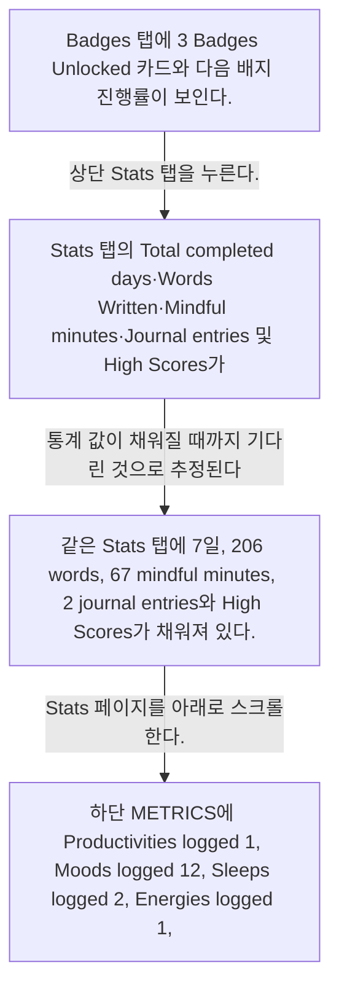
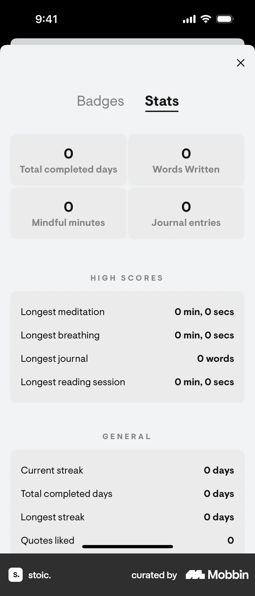
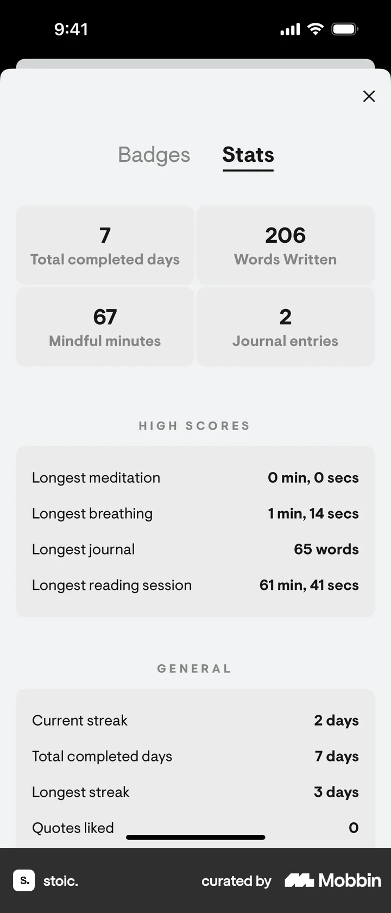
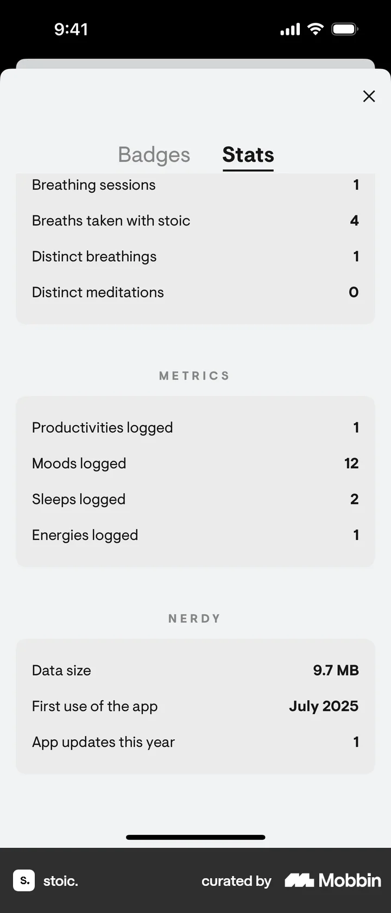

# Stats

- Mobbin 상세 페이지: https://mobbin.com/flows/57119b1d-79de-4199-b288-cf49b237d13c?tab=screens
- 앱·기기: stoic. iOS, 393×852
- 화면 수: 상세 페이지 4장 / 저장 이미지 4장 / 아래 설명 4개
- 검증 상태: **blocked** — 2→3의 0 통계가 7일·206단어로 바뀐 원인과 입력을 캡처에서 확인할 수 없다.

## 화면별 기록

1.  Badges 탭에 3 Badges Unlocked 카드와 다음 배지 진행률이 보인다. 상단 `Stats` 탭을 누른다. 다음 화면에서는 Stats 탭의 Total completed days·Words Written·Mindful minutes·Journal entries 및 High Scores가 모두 0으로 보인다.
2.  Stats 탭의 Total completed days·Words Written·Mindful minutes·Journal entries 및 High Scores가 모두 0으로 보인다. 통계 값이 채워질 때까지 기다린 것으로 추정된다. 입력은 화면에서 확인 불가. 다음 화면에서는 같은 Stats 탭에 7일, 206 words, 67 mindful minutes, 2 journal entries와 High Scores가 채워져 있다.
3.  같은 Stats 탭에 7일, 206 words, 67 mindful minutes, 2 journal entries와 High Scores가 채워져 있다. Stats 페이지를 아래로 스크롤한다. 다음 화면에서는 하단 METRICS에 Productivities logged 1, Moods logged 12, Sleeps logged 2, Energies logged 1, NERDY에 Data size 9.7 MB가 보인다.
4.  하단 METRICS에 Productivities logged 1, Moods logged 12, Sleeps logged 2, Energies logged 1, NERDY에 Data size 9.7 MB가 보인다.

## BMad handoff notes

- **관찰된 진입 상태:** Badges 탭에서 Stats로 이동 가능.
- **주요 행동:** Stats를 열고 하단까지 스크롤한다.
- **기대 결과:** 활동 통계와 기록 지표가 표시된다. 0에서 실제 값으로 채워진 원인은 화면에서 확인 불가.
- **되돌릴 수 있거나 파괴적인 동작:** Badges 탭으로 되돌아갈 수 있다. 삭제 동작은 없다.
