# Subscribing to premium from Onboarding

- Mobbin 상세 페이지: https://mobbin.com/flows/3b7a09b5-ff45-4211-934c-9d92c60be08a?tab=screens
- 앱·기기: stoic. iOS, 393×852
- 화면 수: 상세 페이지 13장 / 저장 이미지 13장 / 아래 설명 13개
- 검증 상태: **verified** — 목록 카드 제목과 상세 제목 `Subscribing to premium on stoic.` 및 URL을 대조했고 이미지 1~13의 순서와 상태 변화를 확인했다.

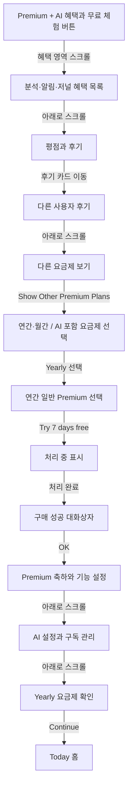

## 화면별 기록

1.  Premium + AI 제안에 AI 혜택과 연간 $99.99, `Try 3 days free`가 보인다. 혜택 영역을 아래로 내리면 다음 화면에서 기능 목록의 하단이 나타난다.
2. 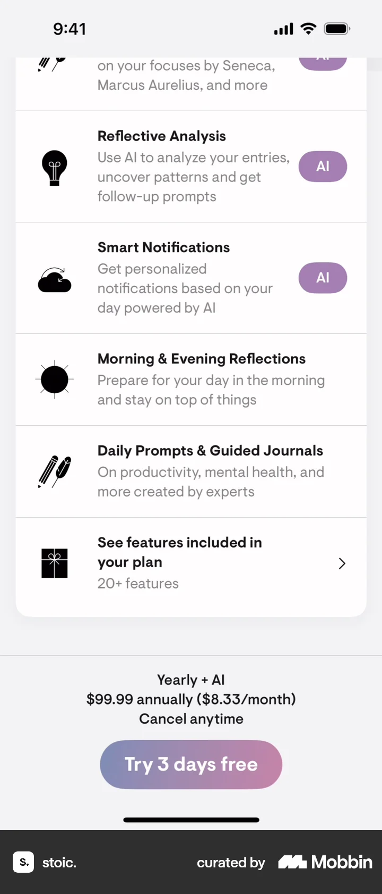 `Reflective Analysis`, `Smart Notifications`, `Morning & Evening Reflections`, `Daily Prompts & Guided Journals`, `See features included in your plan`이 보인다. 아래로 더 스크롤하면 별점과 사용자 후기가 표시된다.
3. 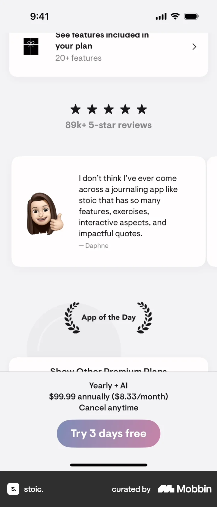 5개 별과 `89k+ 5-star reviews`, 사용자 후기 카드가 표시된다. 후기 카드를 이동하면 다음 화면에서 다른 후기가 보인다.
4. 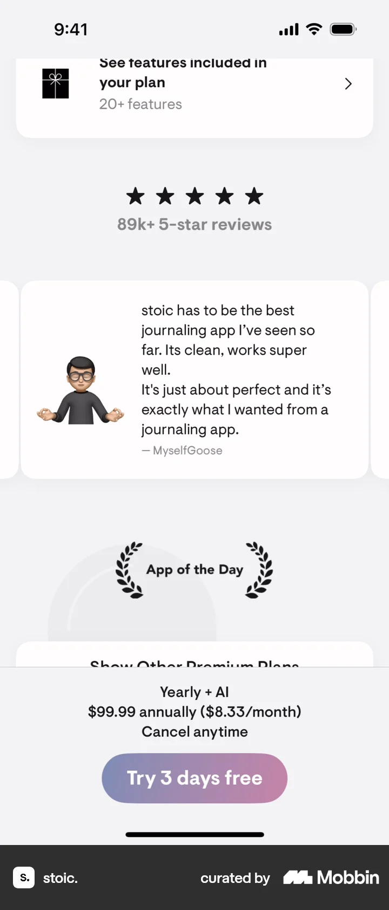 다른 사용자 후기 아래에도 연간 + AI 가격과 무료 체험 버튼이 고정되어 있다. 아래로 스크롤하면 `Show Other Premium Plans`가 나온다.
5. 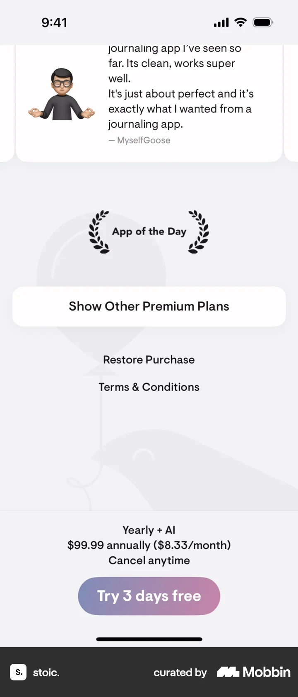 화면 하단에 `Show Other Premium Plans`, `Restore Purchase`, `Terms & Conditions`가 보인다. `Show Other Premium Plans`를 누르면 네 가지 요금제 선택 화면으로 이동한다.
6. 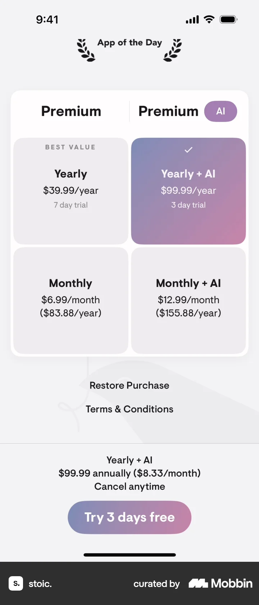 일반 Premium과 Premium AI 각각의 연간·월간 가격 네 칸이 나타나며 `Yearly + AI`가 선택되어 있다. 일반 `Yearly`를 선택하면 다음 화면에서 그 칸이 검게 강조되고 하단 가격이 바뀐다.
7. 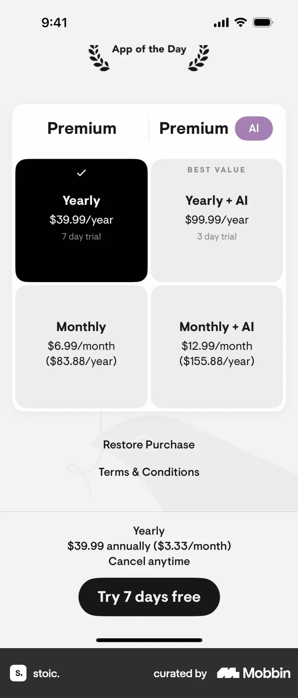 일반 Premium `Yearly $39.99/year`가 검게 선택되어 있고 하단에 `Try 7 days free`가 표시된다. 이 버튼을 누른 뒤 다음 화면은 처리 중 상태다.
8. 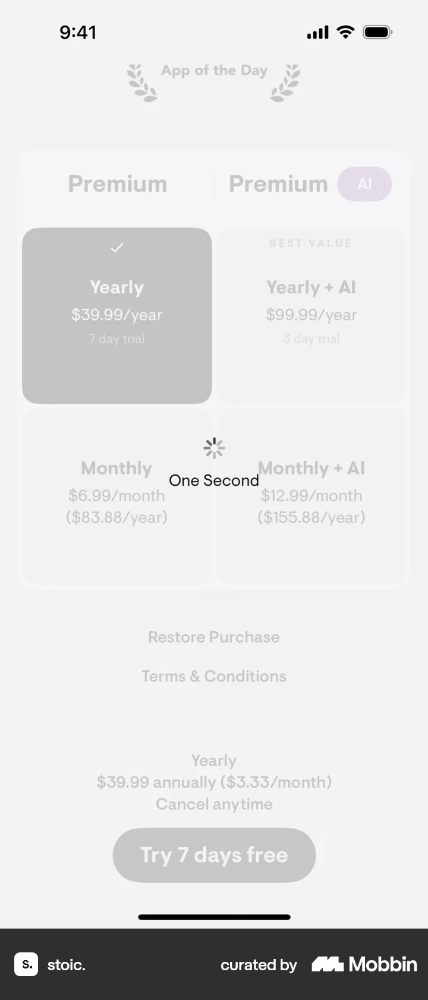 요금제 화면이 흐려지고 `One Second` 로딩 표시가 겹쳐 있다. 처리 완료 후 다음 화면에서 구매 성공 대화상자가 나타난다.
9. 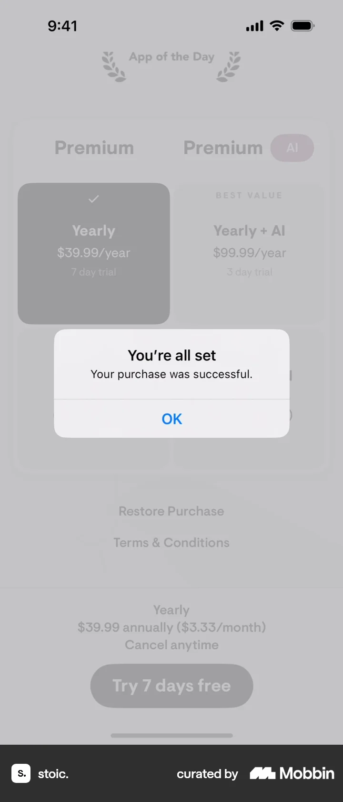 iOS 대화상자에 `You're all set`과 `Your purchase was successful.`이 명시되어 있다. `OK`를 누르면 Premium 기능 안내로 이동한다.
10. 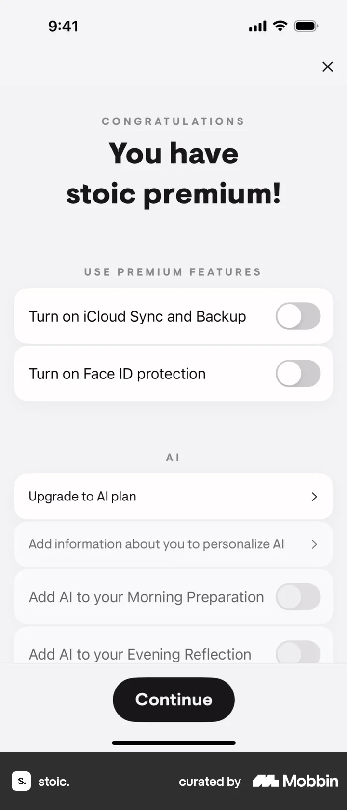 `You have stoic premium!` 아래 iCloud 동기화·Face ID 보호 토글과 AI 플랜 업그레이드 항목이 보인다. 아래로 스크롤하면 AI 옵션과 구독 관리 항목이 더 표시된다.
11. 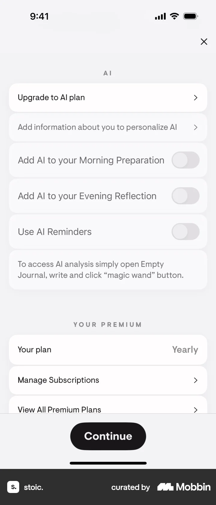 `Upgrade to AI plan`, 개인화 정보, AI 성찰·알림 토글과 `Your plan: Yearly`, `Manage Subscriptions`가 보인다. 아래로 내리면 구독 정보와 감사 문구가 나타난다.
12. 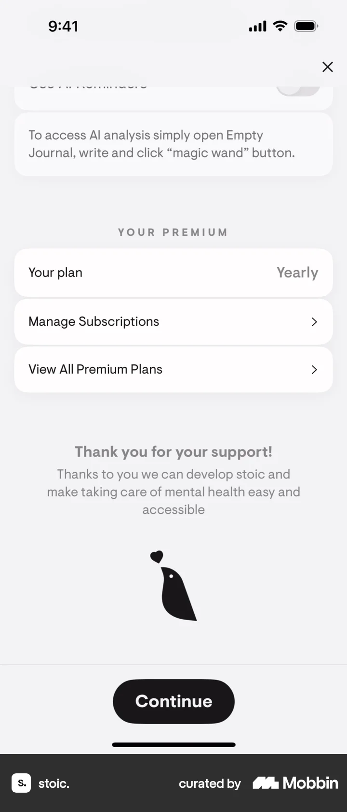 `Your plan: Yearly`, `Manage Subscriptions`, `View All Premium Plans`와 지원 감사 문구가 보인다. `Continue`로 진행하면 Today 홈으로 이동한다.
13. 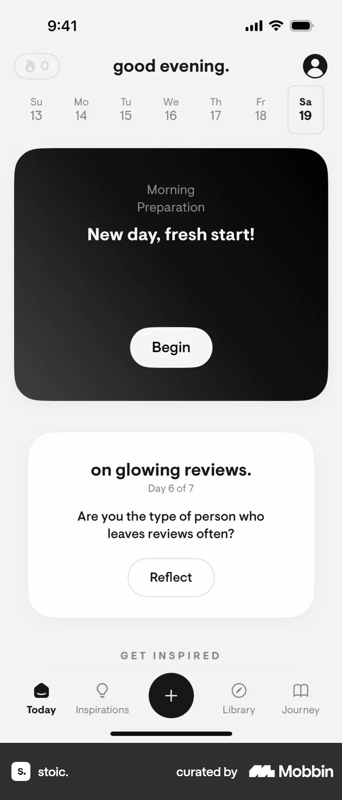 Today 탭에 `good evening.`, `Morning Preparation`의 `Begin`, 성찰 카드의 `Reflect`가 보인다. 이후 실제 사용이나 구독 관리 결과는 화면에서 확인 불가.

## BMad handoff notes

- **관찰된 진입 상태:** 온보딩 직후 Premium + AI 제안 화면에서 시작한다.
- **주요 행동:** 혜택과 후기를 살펴본 뒤 다른 요금제를 열고 일반 Premium 연간 플랜을 선택해 `Try 7 days free`로 진행한다.
- **기대 결과:** 구매 성공 대화상자, Premium 기능 안내, `Your plan: Yearly` 확인 후 Today 홈이 표시된다.
- **되돌릴 수 있거나 파괴적인 동작:** `Manage Subscriptions`와 `Restore Purchase` 진입점은 보인다. 무료 체험의 실제 청구·취소 시점과 취소 결과는 화면에서 확인 불가. 삭제 동작은 없다.
