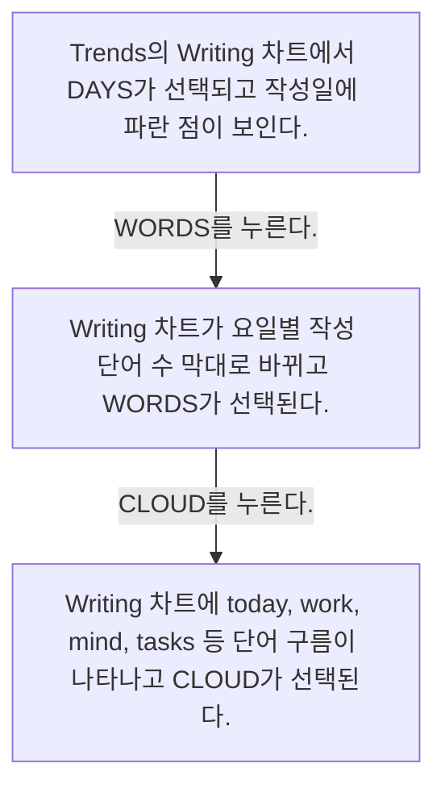
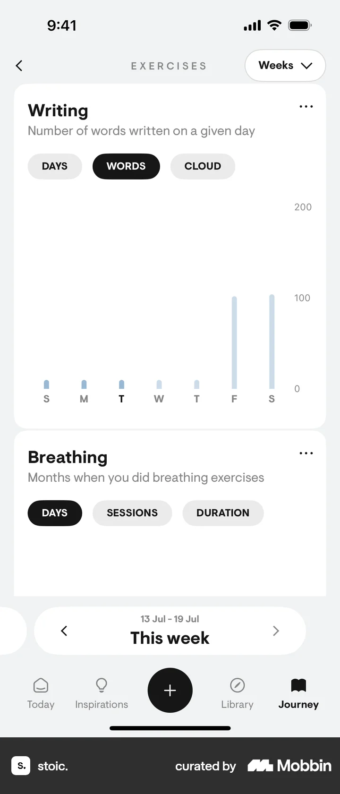

# Switching data views from Trends & insights

- Mobbin 상세 페이지: https://mobbin.com/flows/a6b44744-1289-4c69-9b53-871f002940ac?tab=screens
- 앱·기기: stoic. iOS, 393×852
- 화면 수: 상세 페이지 3장 / 저장 이미지 3장 / 아래 설명 3개
- 검증 상태: **verified** — 목록 제목·상세 제목·URL과 화면별 이미지 수·순서·상태 변화를 대조했다.

## 화면별 기록

1.  Trends의 Writing 차트에서 `DAYS`가 선택되고 작성일에 파란 점이 보인다. `WORDS`를 누른다. 다음 화면에서는 Writing 차트가 요일별 작성 단어 수 막대로 바뀌고 `WORDS`가 선택된다.
2.  Writing 차트가 요일별 작성 단어 수 막대로 바뀌고 `WORDS`가 선택된다. `CLOUD`를 누른다. 다음 화면에서는 Writing 차트에 `today`, `work`, `mind`, `tasks` 등 단어 구름이 나타나고 `CLOUD`가 선택된다.
3.  Writing 차트에 `today`, `work`, `mind`, `tasks` 등 단어 구름이 나타나고 `CLOUD`가 선택된다.

## BMad handoff notes

- **관찰된 진입 상태:** Writing 차트가 DAYS 보기다.
- **주요 행동:** WORDS와 CLOUD 탭을 차례로 선택한다.
- **기대 결과:** 작성일 점 → 단어 수 막대 → 단어 구름으로 표시 방식이 바뀐다.
- **되돌릴 수 있거나 파괴적인 동작:** DAYS·WORDS·CLOUD를 다시 선택해 보기를 바꿀 수 있다. 삭제 동작은 없다.
