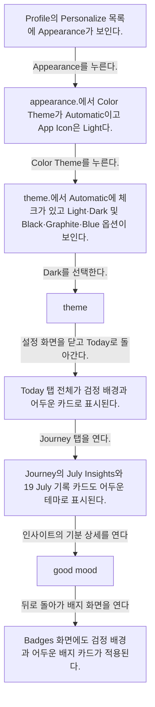

# Switching to dark mode from Profile

- Mobbin 상세 페이지: https://mobbin.com/flows/941037fb-0eab-46ce-a38b-1982117f5571?tab=screens
- 앱·기기: stoic. iOS, 393×852
- 화면 수: 상세 페이지 8장 / 저장 이미지 8장 / 아래 설명 8개
- 검증 상태: **blocked** — 6→7 인사이트 상세와 7→8 배지 화면의 정확한 진입 조작·경로가 캡처에 없다.

## 화면별 기록

1.  Profile의 Personalize 목록에 Appearance가 보인다. `Appearance`를 누른다. 다음 화면에서는 appearance.에서 Color Theme가 Automatic이고 App Icon은 Light다.
2.  appearance.에서 Color Theme가 Automatic이고 App Icon은 Light다. `Color Theme`를 누른다. 다음 화면에서는 theme.에서 Automatic에 체크가 있고 Light·Dark 및 Black·Graphite·Blue 옵션이 보인다.
3.  theme.에서 Automatic에 체크가 있고 Light·Dark 및 Black·Graphite·Blue 옵션이 보인다. `Dark`를 선택한다. 다음 화면에서는 theme. 화면이 검정 배경으로 바뀌고 Dark와 Black에 체크가 있다.
4.  theme. 화면이 검정 배경으로 바뀌고 Dark와 Black에 체크가 있다. 설정 화면을 닫고 Today로 돌아간다. 다음 화면에서는 Today 탭 전체가 검정 배경과 어두운 카드로 표시된다.
5.  Today 탭 전체가 검정 배경과 어두운 카드로 표시된다. Journey 탭을 연다. 다음 화면에서는 Journey의 July Insights와 19 July 기록 카드도 어두운 테마로 표시된다.
6.  Journey의 July Insights와 19 July 기록 카드도 어두운 테마로 표시된다. 인사이트의 기분 상세를 연다. 정확한 터치 위치는 화면에서 확인 불가. 다음 화면에서는 `good mood.` 주간 그래프와 Top activities 카드가 어두운 테마로 표시된다.
7.  `good mood.` 주간 그래프와 Top activities 카드가 어두운 테마로 표시된다. 뒤로 돌아가 배지 화면을 연다. 중간 경로는 화면에서 확인 불가. 다음 화면에서는 Badges 화면에도 검정 배경과 어두운 배지 카드가 적용된다.
8.  Badges 화면에도 검정 배경과 어두운 배지 카드가 적용된다.

## BMad handoff notes

- **관찰된 진입 상태:** Profile의 Appearance에서 테마가 Automatic이다.
- **주요 행동:** Color Theme을 Dark로 바꾼 뒤 Today·Journey·인사이트·Badges에서 적용 상태를 확인한다.
- **기대 결과:** 여러 화면에 Dark 테마가 적용된다.
- **되돌릴 수 있거나 파괴적인 동작:** 테마 목록에 Automatic과 Light가 있어 재선택 가능하다. 삭제 동작은 없다.
