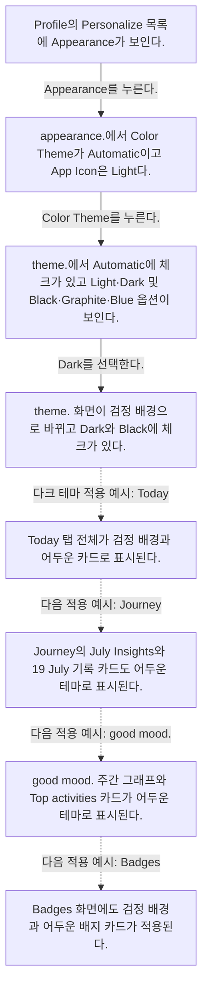
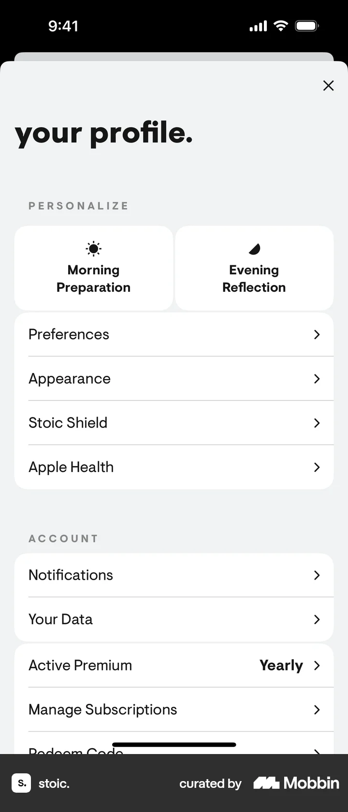
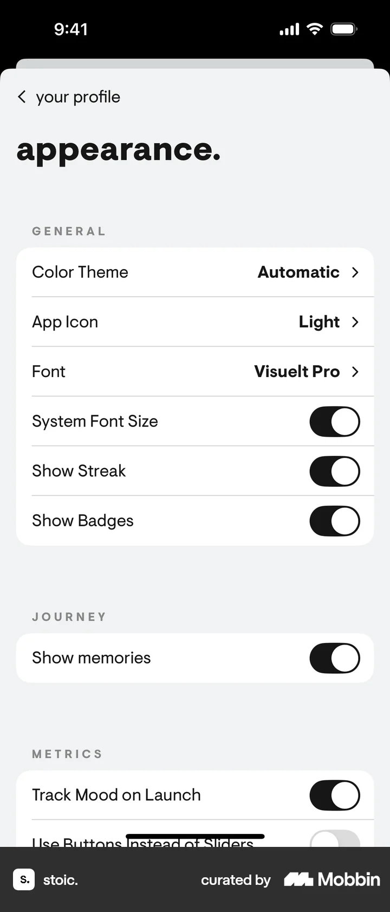
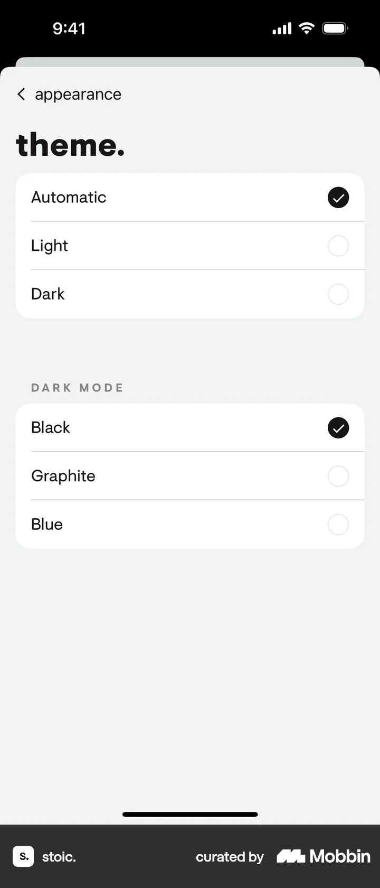
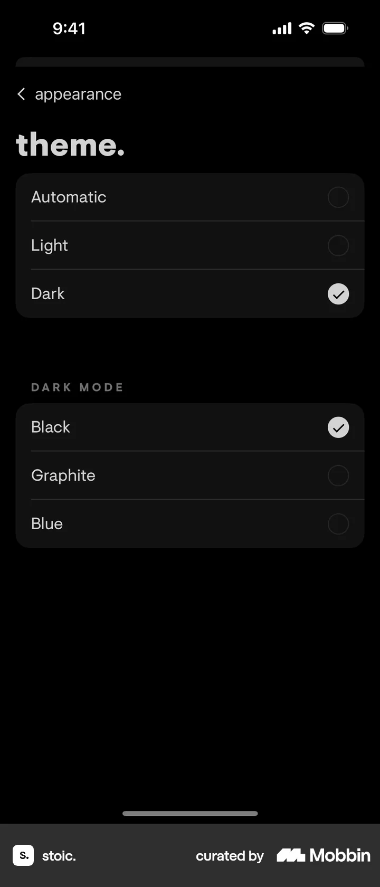
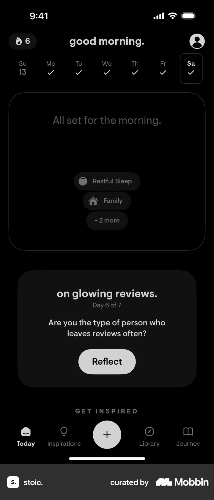
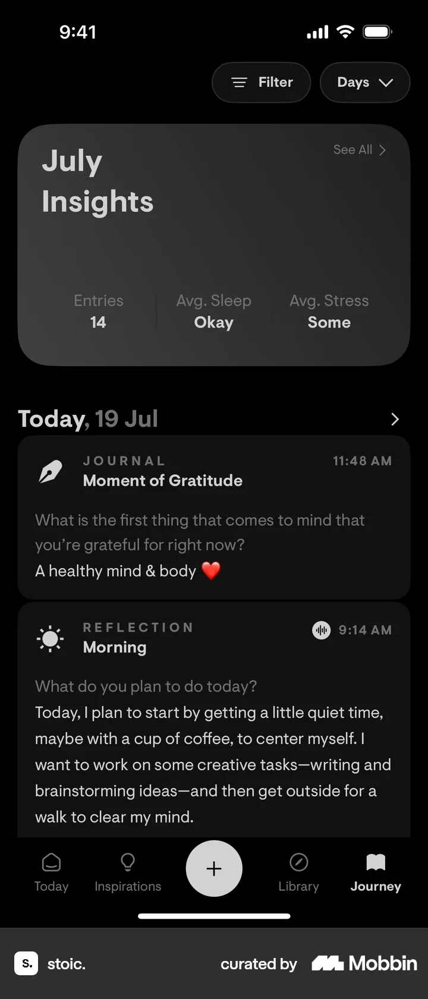
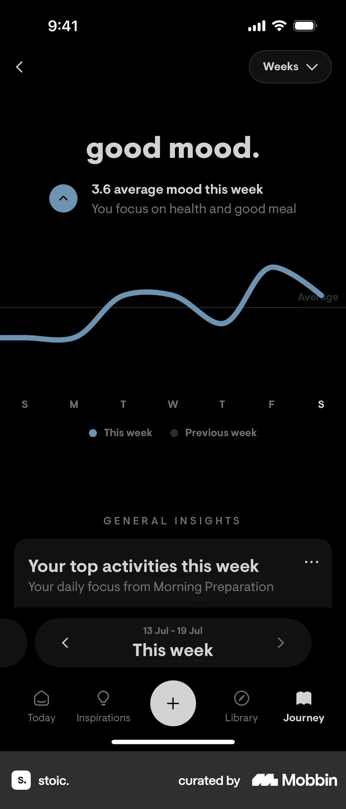
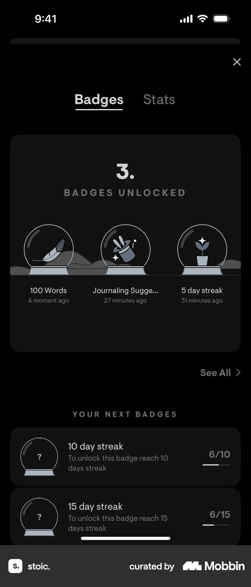

# Switching to dark mode from Profile

- Mobbin 상세 페이지: https://mobbin.com/flows/941037fb-0eab-46ce-a38b-1982117f5571?tab=screens
- 앱·기기: stoic. iOS, 393×852
- 화면 수: 상세 페이지 8장 / 저장 이미지 8장 / 아래 설명 8개
- 검증 상태: **verified** — 1~4번은 Dark 테마 선택 과정이고, 5~8번은 기존 화면에서 Dark 테마가 적용된 모습을 순서대로 보여 주는 예시다(사용자 확인). 예시 화면 사이의 이동 조작은 이 상세 페이지의 기록 대상이 아니다.

## 화면별 기록

1.  Profile의 Personalize 목록에 Appearance가 보인다. `Appearance`를 누른다. 다음 화면에서는 appearance.에서 Color Theme가 Automatic이고 App Icon은 Light다.
2.  appearance.에서 Color Theme가 Automatic이고 App Icon은 Light다. `Color Theme`를 누른다. 다음 화면에서는 theme.에서 Automatic에 체크가 있고 Light·Dark 및 Black·Graphite·Blue 옵션이 보인다.
3.  theme.에서 Automatic에 체크가 있고 Light·Dark 및 Black·Graphite·Blue 옵션이 보인다. `Dark`를 선택한다. 다음 화면에서는 theme. 화면이 검정 배경으로 바뀌고 Dark와 Black에 체크가 있다.
4.  `Dark` 선택 결과 theme. 화면이 검정 배경으로 바뀌고 Dark와 Black에 체크가 있다. 다음 캡처부터는 기존 화면에서 다크 테마가 어떻게 보이는지 보여 준다. 화면 5로 가는 조작은 기록되지 않았다.
5.  적용 예시: Today 탭 전체가 검정 배경과 어두운 카드로 표시된다. 다음 캡처는 Journey의 다크 테마 모습이다. 두 캡처 사이의 이동 조작은 화면에서 확인 불가.
6.  적용 예시: Journey의 July Insights와 19 July 기록 카드도 어두운 테마로 표시된다. 다음 캡처는 `good mood.` 인사이트의 다크 테마 모습이다. 두 캡처 사이의 이동 조작은 화면에서 확인 불가.
7.  적용 예시: `good mood.` 주간 그래프와 Top activities 카드가 어두운 테마로 표시된다. 다음 캡처는 Badges의 다크 테마 모습이다. 두 캡처 사이의 이동 조작은 화면에서 확인 불가.
8.  적용 예시: Badges 화면에도 검정 배경과 어두운 배지 카드가 적용된다. 이 네 적용 예시 사이의 화면 전환은 재현 단계로 취급하지 않는다.

## BMad handoff notes

- **관찰된 진입 상태:** Profile의 Appearance에서 테마가 Automatic이다.
- **주요 행동:** Color Theme을 Dark로 선택한다. 이후 캡처는 Today·Journey·인사이트·Badges의 적용 결과를 보여 주며, 캡처 사이의 이동 경로는 기록되지 않았다.
- **기대 결과:** 여러 화면에 Dark 테마가 적용된다.
- **되돌릴 수 있거나 파괴적인 동작:** 테마 목록에 Automatic과 Light가 있어 재선택 가능하다. 삭제 동작은 없다.
