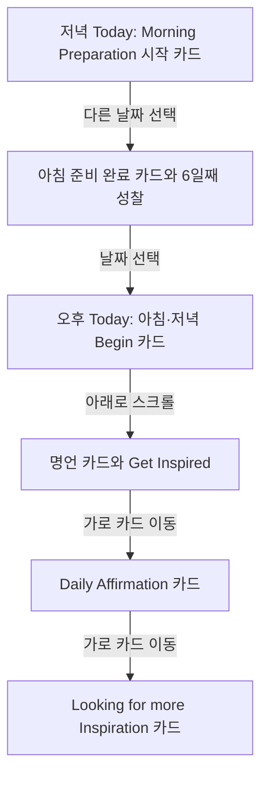
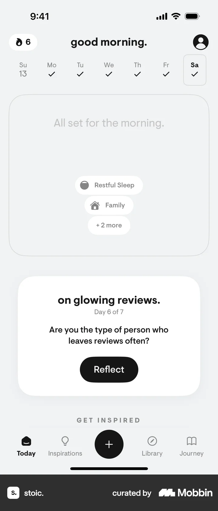
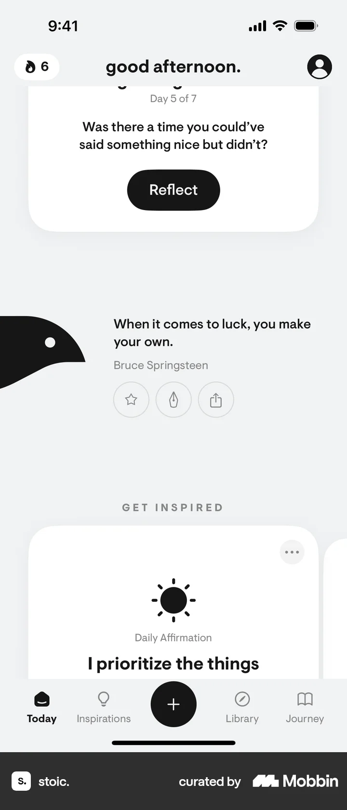
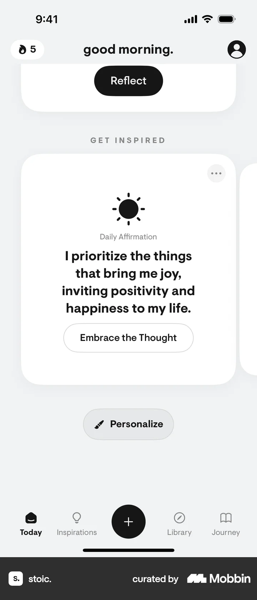
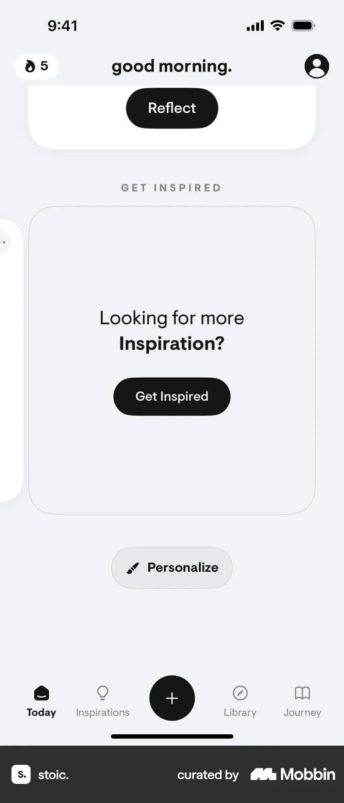

# Today

- Mobbin 상세 페이지: https://mobbin.com/flows/b72044fc-f724-4356-9805-2a17626668bd?tab=screens
- 앱·기기: stoic. iOS, 393×852
- 화면 수: 상세 페이지 6장 / 저장 이미지 6장 / 아래 설명 6개
- 검증 상태: **verified** — 목록 카드 `Today`, 상세 제목 `Today on stoic.`와 URL, 이미지 순서를 대조했다.

## 화면별 기록

1.  `good evening.`과 19일 선택 상태 아래 `Morning Preparation`의 `New day, fresh start! / Begin`, `on glowing reviews.`의 `Reflect`가 보인다. 상단 주간 날짜를 바꾸면 다음 화면에서 다른 날짜의 Today 내용이 나온다. 정확히 어느 날짜를 눌렀는지는 화면에서 확인 불가.
2.  상단 주간 날짜에 여러 완료 체크가 있고 `All set for the morning.` 카드와 `on glowing reviews.` 6일째 성찰 카드가 보인다. 날짜 선택 후 다음 화면에는 오후 인사와 아침·저녁 카드가 나온다.
3.  `good afternoon.`과 18일 선택 상태, `Morning Preparation`·`Evening Reflection` 두 `Begin` 카드, 5일째 성찰 카드가 나타난다. 아래로 스크롤하면 명언과 영감 영역이 보인다.
4.  Bruce Springsteen 명언과 즐겨찾기·공유 아이콘, `GET INSPIRED` 영역의 Daily Affirmation 카드 일부가 보인다. 영감 카드 열을 가로로 이동하면 다음 화면에서 affirmation이 중앙에 온다.
5.  Daily Affirmation 카드에 `I prioritize the things that bring me joy...`와 `Embrace the Thought`, 아래 `Personalize`가 표시된다. 카드 열을 더 이동하면 영감 탐색 카드가 나타난다.
6.  `Looking for more Inspiration?` 카드에 `Get Inspired` 버튼이 보이고 아래에 `Personalize`가 유지된다. 버튼을 눌렀을 때의 결과는 이 플로우에서 확인 불가.

## BMad handoff notes

- **관찰된 진입 상태:** Today 탭의 날짜별 인사, 루틴 카드와 성찰 카드.
- **주요 행동:** 상단 날짜를 바꾸고 페이지를 아래로 내려 명언·영감 카드를 가로로 탐색한다.
- **기대 결과:** 선택 날짜의 루틴과 성찰 상태가 바뀌고 다른 영감 카드가 보인다.
- **되돌릴 수 있거나 파괴적인 동작:** 날짜와 카드 탐색은 되돌릴 수 있다. 삭제·구독·저장 동작은 관찰되지 않는다.
