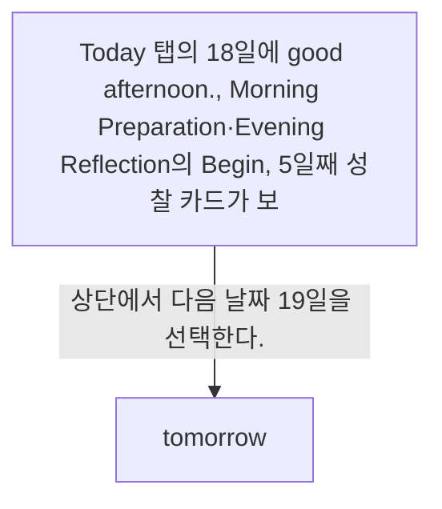

# Tomorrow from Today

- Mobbin 상세 페이지: https://mobbin.com/flows/ee3b14c9-237b-4c21-b67a-c6850e0ac077?tab=screens
- 앱·기기: stoic. iOS, 393×852
- 화면 수: 상세 페이지 2장 / 저장 이미지 2장 / 아래 설명 2개
- 검증 상태: **verified** — 목록 제목·상세 제목·URL과 화면별 이미지 수·순서·상태 변화를 대조했다.

## 화면별 기록

1.  Today 탭의 18일에 `good afternoon.`, Morning Preparation·Evening Reflection의 `Begin`, 5일째 성찰 카드가 보인다. 상단에서 다음 날짜 19일을 선택한다. 다음 화면에서는 `tomorrow.` 화면에는 검은 새와 `Tomorrow's activities will be ready in 9hrs 16min 53secs` 카운트다운이 보이고 루틴 카드는 없다.
2.  `tomorrow.` 화면에는 검은 새와 `Tomorrow's activities will be ready in 9hrs 16min 53secs` 카운트다운이 보이고 루틴 카드는 없다.

## BMad handoff notes

- **관찰된 진입 상태:** Today 탭에서 현재 날짜의 루틴과 성찰 카드가 보이는 상태.
- **주요 행동:** 상단 주간 날짜에서 다음 날을 선택한다.
- **기대 결과:** 미래 날짜에는 활동 준비까지 남은 시간이 표시된다. 실제 활동 생성 시점은 화면에서 확인 불가.
- **되돌릴 수 있거나 파괴적인 동작:** 날짜를 다시 선택할 수 있다. 삭제 동작은 없다.
