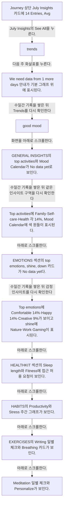
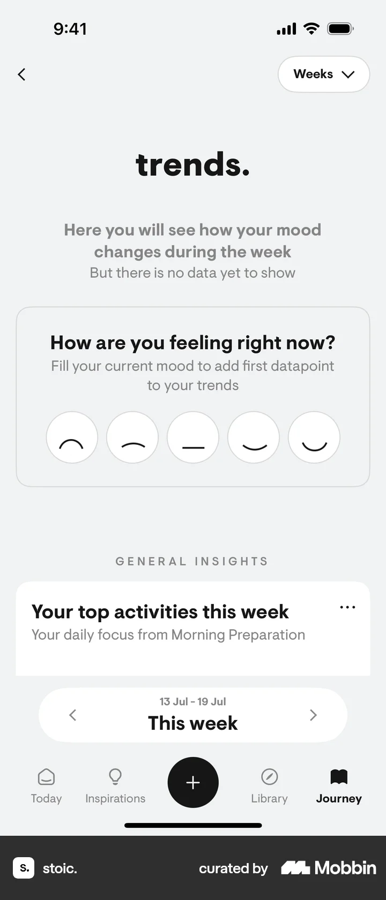
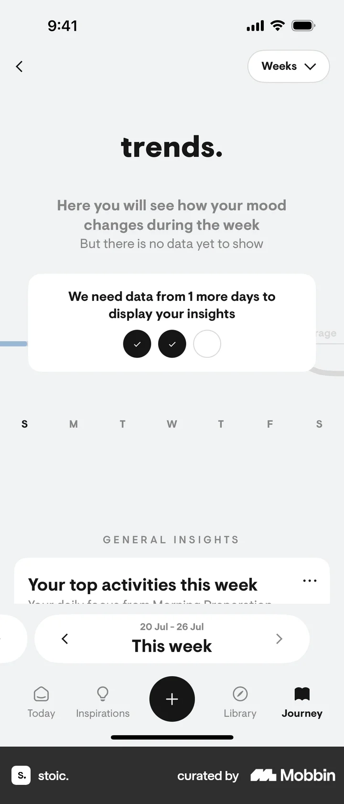
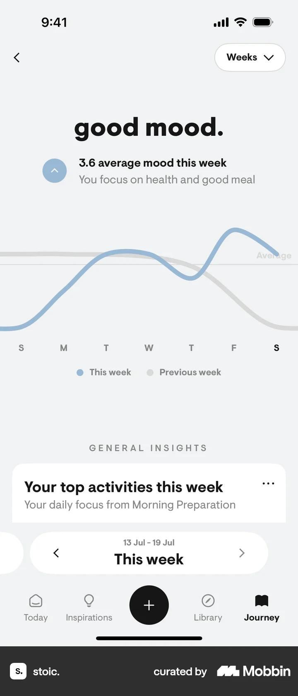
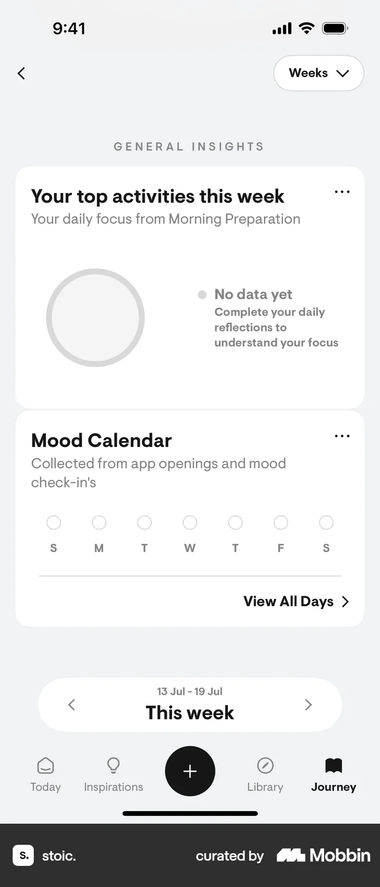
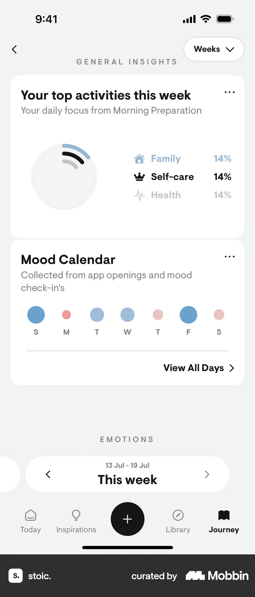
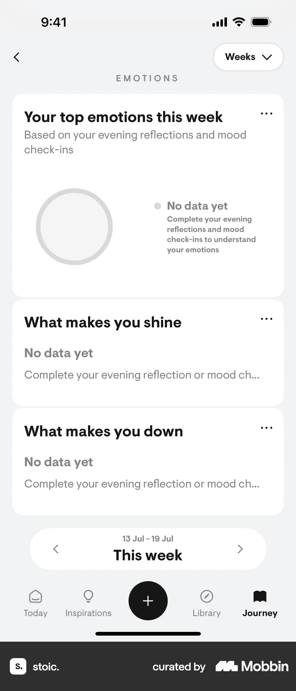
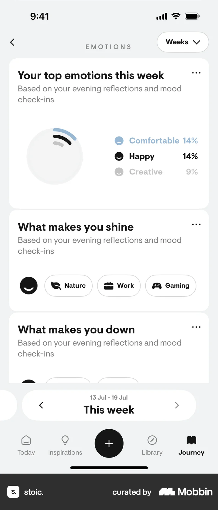
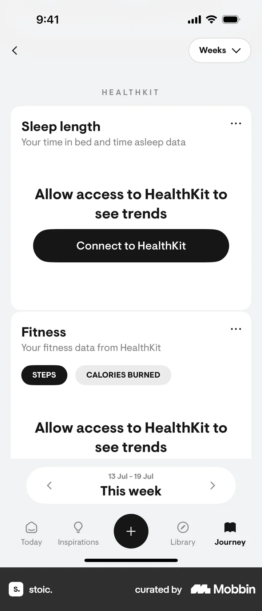
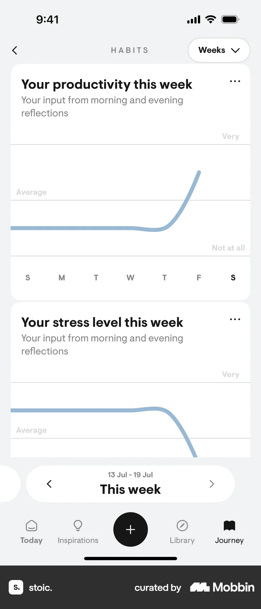

# Trends & insights from Journey

- Mobbin 상세 페이지: https://mobbin.com/flows/d5e37110-80a8-46b2-bb64-92db47de8c14?tab=screens
- 앱·기기: stoic. iOS, 393×852
- 화면 수: 상세 페이지 12장 / 저장 이미지 12장 / 아래 설명 12개
- 검증 상태: **verified** — 목록·상세 제목·URL과 이미지 12장의 순서를 대조했다. `No data yet`에서 그래프·비율로 바뀐 화면은 사용자가 수일에 걸쳐 앱을 사용하며 기록을 쌓은 뒤의 캡처임을 확인했다. 즉시 로딩이나 기간 변경의 결과로 해석하지 않는다.

## 화면별 기록

1.  Journey 상단 July Insights 카드에 14 Entries, Avg. Sleep Okay, Avg. Stress Some이 보인다. July Insights의 `See All`을 누른다. 다음 화면에서는 trends. 주간 화면에 기분 데이터 없음, 감정 얼굴, Your top activities 카드가 보인다.
2.  trends. 주간 화면에 기분 데이터 없음, 감정 얼굴, Your top activities 카드가 보인다. 다음 주 화살표를 누른다. 다음 화면에서는 `We need data from 1 more days` 안내가 기분 그래프 위에 표시된다.
3.  `We need data from 1 more days` 안내가 기분 그래프 위에 표시된다. 수일간 앱을 사용해 기록을 쌓은 뒤 Trends를 다시 확인한다(사용자 확인). 중간 기록 화면은 이 상세 페이지에 없다. 다음 화면에서는 `good mood.` 3.6 average mood this week와 파란 기분 그래프가 보인다.
4.  `good mood.` 3.6 average mood this week와 파란 기분 그래프가 보인다. 화면을 아래로 스크롤한다. 다음 화면에서는 GENERAL INSIGHTS의 top activities와 Mood Calendar가 `No data yet`로 보인다.
5.  GENERAL INSIGHTS의 top activities와 Mood Calendar가 `No data yet`로 보인다. 수일간 앱을 사용해 기록이 누적된 뒤 같은 인사이트 구역을 다시 확인한다(사용자 확인). 중간 기록 화면은 이 상세 페이지에 없다. 다음 화면에서는 Top activities에 Family·Self-care·Health 각 14%, Mood Calendar에 색 원들이 표시된다.
6.  Top activities에 Family·Self-care·Health 각 14%, Mood Calendar에 색 원들이 표시된다. 아래로 스크롤한다. 다음 화면에서는 EMOTIONS 섹션의 top emotions, shine, down 카드가 `No data yet`다.
7.  EMOTIONS 섹션의 top emotions, shine, down 카드가 `No data yet`다. 수일간 앱을 사용해 기록이 누적된 뒤 같은 인사이트 구역을 다시 확인한다(사용자 확인). 중간 기록 화면은 이 상세 페이지에 없다. 다음 화면에서는 Top emotions에 Comfortable 14%·Happy 14%·Creative 9%가 보이고 shine에 Nature·Work·Gaming이 표시된다.
8.  Top emotions에 Comfortable 14%·Happy 14%·Creative 9%가 보이고 shine에 Nature·Work·Gaming이 표시된다. 아래로 스크롤한다. 다음 화면에서는 HEALTHKIT 섹션의 Sleep length와 Fitness에 접근 허용 요청이 보인다.
9.  HEALTHKIT 섹션의 Sleep length와 Fitness에 접근 허용 요청이 보인다. 아래로 스크롤한다. 다음 화면에서는 HABITS의 Productivity와 Stress 주간 그래프가 보인다.
10.  HABITS의 Productivity와 Stress 주간 그래프가 보인다. 아래로 스크롤한다. 다음 화면에서는 EXERCISES의 Writing 일별 체크와 Breathing 카드가 보인다.
11.  EXERCISES의 Writing 일별 체크와 Breathing 카드가 보인다. 아래로 스크롤한다. 다음 화면에서는 Meditation 일별 체크와 `Personalize`가 보인다.
12.  Meditation 일별 체크와 `Personalize`가 보인다.

## BMad handoff notes

- **관찰된 진입 상태:** Journey의 July Insights 요약 카드.
- **주요 행동:** See All에서 주간 추세를 열고, 수일간 기록 누적 전후의 활동·감정 결과를 비교하며 건강·습관·운동 카드까지 스크롤한다.
- **기대 결과:** 기분 그래프와 활동·감정 비율, HealthKit 연결 요청 및 운동 기록 카드가 표시된다.
- **되돌릴 수 있거나 파괴적인 동작:** 주간 이전·다음 화살표 및 뒤로 가기가 보인다. 숨김·삭제는 이 플로우에서 확인 불가.
