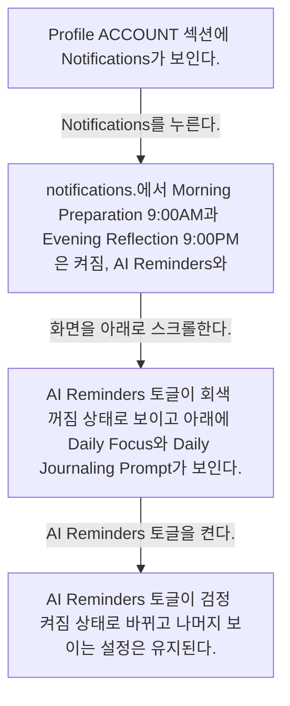
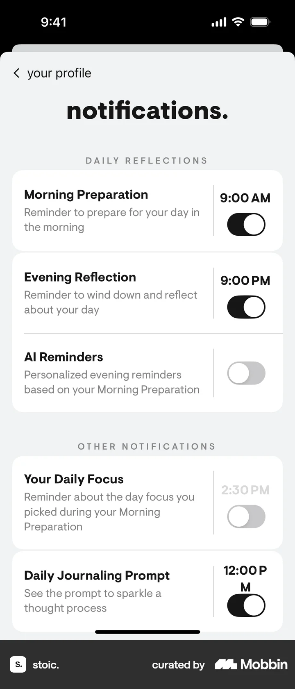
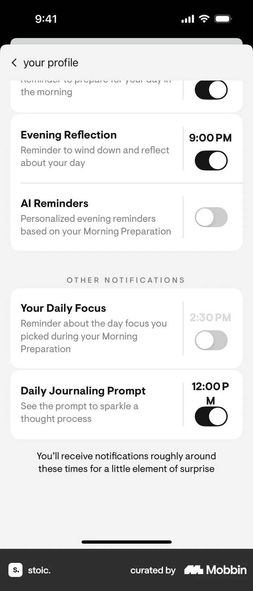
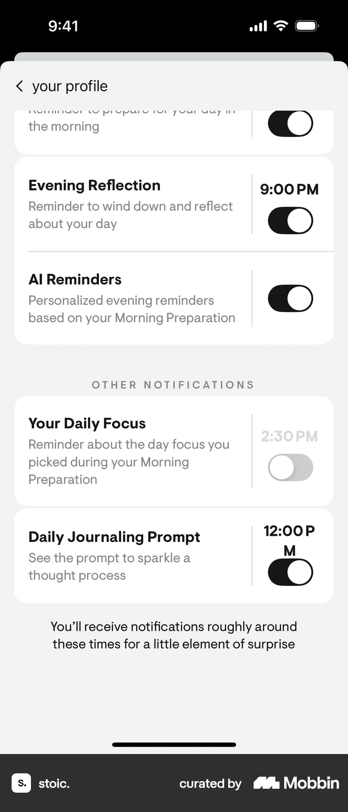

# Turning on notifications from Profile

- Mobbin 상세 페이지: https://mobbin.com/flows/8efdc6cc-bf7c-43a4-9783-10711f9eedd3?tab=screens
- 앱·기기: stoic. iOS, 393×852
- 화면 수: 상세 페이지 4장 / 저장 이미지 4장 / 아래 설명 4개
- 검증 상태: **verified** — 목록 제목·상세 제목·URL과 화면별 이미지 수·순서·상태 변화를 대조했다.

## 화면별 기록

1.  Profile ACCOUNT 섹션에 Notifications가 보인다. `Notifications`를 누른다. 다음 화면에서는 notifications.에서 Morning Preparation 9:00AM과 Evening Reflection 9:00PM은 켜짐, AI Reminders와 Daily Focus는 꺼짐, Daily Journaling Prompt는 켜짐이다.
2.  notifications.에서 Morning Preparation 9:00AM과 Evening Reflection 9:00PM은 켜짐, AI Reminders와 Daily Focus는 꺼짐, Daily Journaling Prompt는 켜짐이다. 화면을 아래로 스크롤한다. 다음 화면에서는 AI Reminders 토글이 회색 꺼짐 상태로 보이고 아래에 Daily Focus와 Daily Journaling Prompt가 보인다.
3.  AI Reminders 토글이 회색 꺼짐 상태로 보이고 아래에 Daily Focus와 Daily Journaling Prompt가 보인다. `AI Reminders` 토글을 켠다. 다음 화면에서는 AI Reminders 토글이 검정 켜짐 상태로 바뀌고 나머지 보이는 설정은 유지된다.
4.  AI Reminders 토글이 검정 켜짐 상태로 바뀌고 나머지 보이는 설정은 유지된다.

## BMad handoff notes

- **관찰된 진입 상태:** Profile의 Notifications 설정으로 이동 가능.
- **주요 행동:** 알림 목록을 열고 AI Reminders를 켠다.
- **기대 결과:** AI Reminders 스위치가 켜짐 상태로 표시된다. 시스템 알림 수신 여부는 화면에서 확인 불가.
- **되돌릴 수 있거나 파괴적인 동작:** 토글을 다시 눌러 끌 수 있다. 삭제 동작은 없다.
