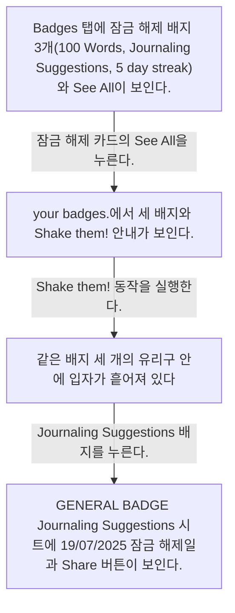
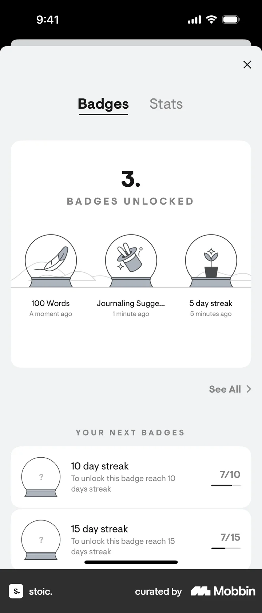
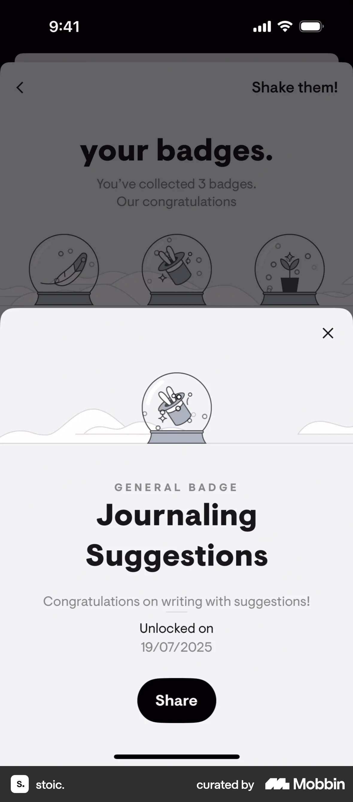

# Unlocked badges from Badges

- Mobbin 상세 페이지: https://mobbin.com/flows/8d436708-ed5c-4afd-8222-06414239bff9?tab=screens
- 앱·기기: stoic. iOS, 393×852
- 화면 수: 상세 페이지 4장 / 저장 이미지 4장 / 아래 설명 4개
- 검증 상태: **blocked** — 2→3 배지 흔들기 효과를 유발한 정확한 사용자 입력은 캡처로 확인할 수 없다.

## 화면별 기록

1.  Badges 탭에 잠금 해제 배지 3개(100 Words, Journaling Suggestions, 5 day streak)와 `See All`이 보인다. 잠금 해제 카드의 `See All`을 누른다. 다음 화면에서는 `your badges.`에서 세 배지와 `Shake them!` 안내가 보인다.
2.  `your badges.`에서 세 배지와 `Shake them!` 안내가 보인다. `Shake them!` 동작을 실행한다. 다음 화면에서는 같은 배지 세 개의 유리구 안에 입자가 흩어져 있다. 실제 기기 흔들기인지 버튼 탭인지는 화면에서 확인 불가.
3.  같은 배지 세 개의 유리구 안에 입자가 흩어져 있다. 실제 기기 흔들기인지 버튼 탭인지는 화면에서 확인 불가. Journaling Suggestions 배지를 누른다. 다음 화면에서는 `GENERAL BADGE Journaling Suggestions` 시트에 19/07/2025 잠금 해제일과 Share 버튼이 보인다.
4.  `GENERAL BADGE Journaling Suggestions` 시트에 19/07/2025 잠금 해제일과 Share 버튼이 보인다.

## BMad handoff notes

- **관찰된 진입 상태:** Badges에서 잠금 해제한 배지 3개가 보인다.
- **주요 행동:** See All을 열고 Shake them! 효과를 본 뒤 Journaling Suggestions를 연다.
- **기대 결과:** 배지 상세에 잠금 해제일과 Share 버튼이 보인다. 실제 공유는 확인 불가.
- **되돌릴 수 있거나 파괴적인 동작:** 배지 상세 시트의 X와 목록 뒤로 가기가 보인다. 삭제 동작은 없다.
