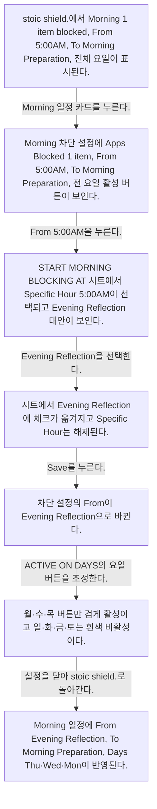
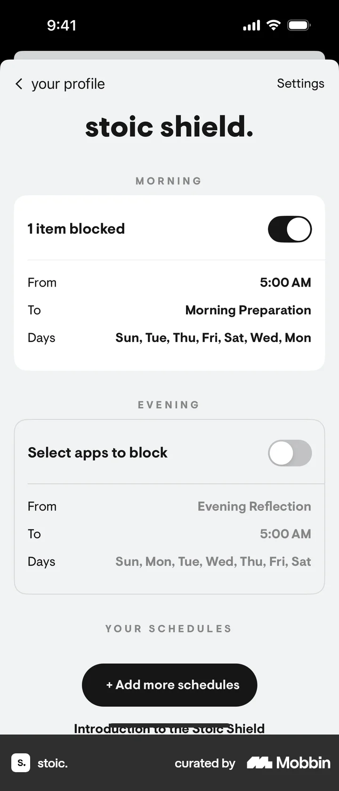
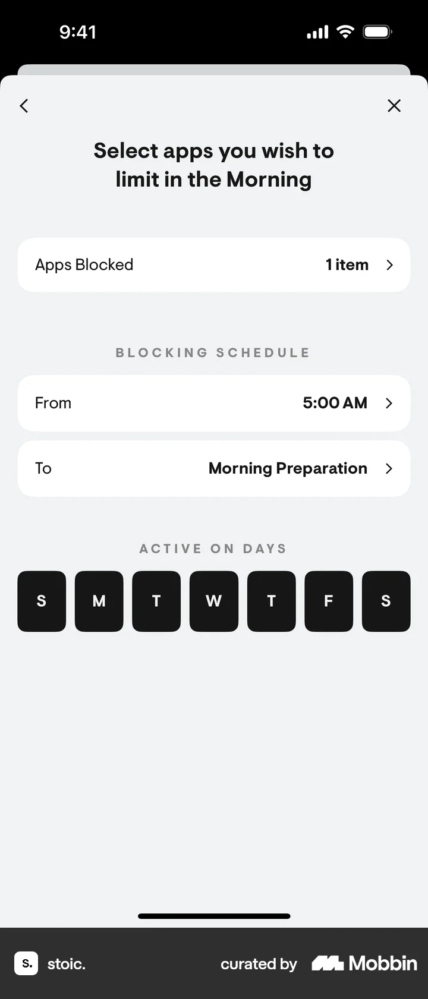
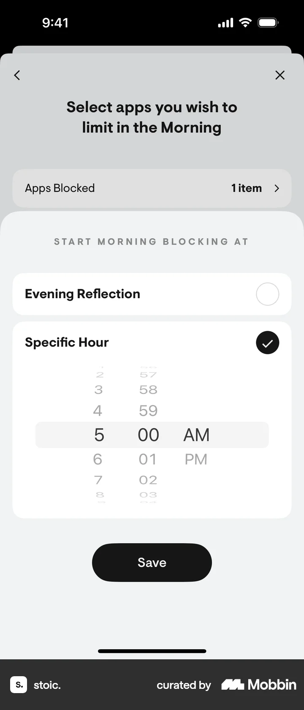
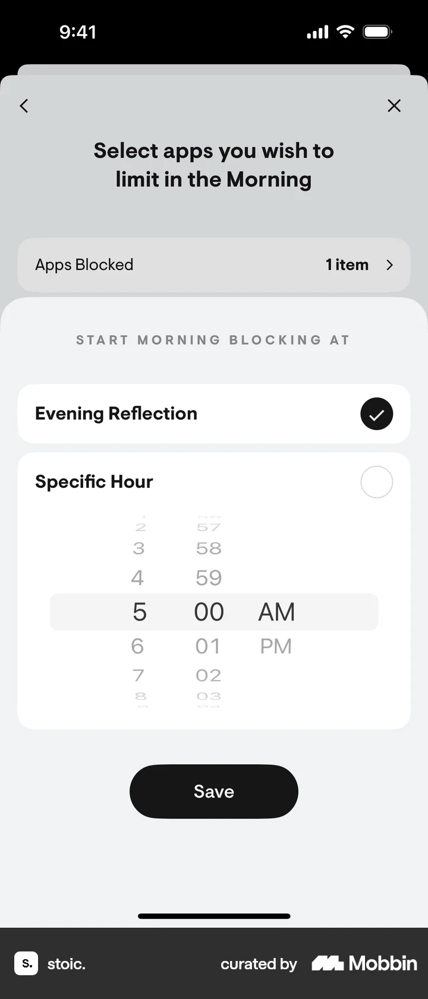
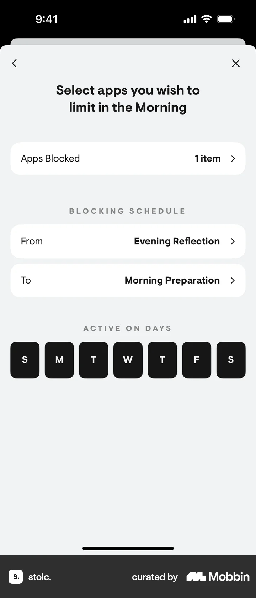
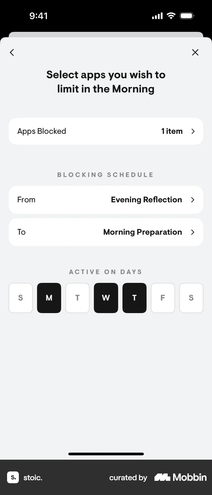
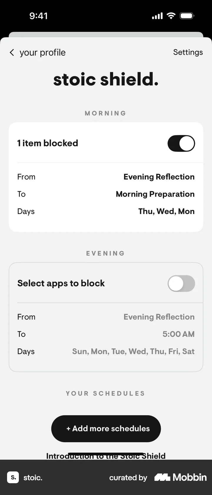

# Updating a blocking schedule from Setting up stoic shield

- Mobbin 상세 페이지: https://mobbin.com/flows/85a22402-a64f-4042-8ecd-13bac9c2aba9?tab=screens
- 앱·기기: stoic. iOS, 393×852
- 화면 수: 상세 페이지 7장 / 저장 이미지 7장 / 아래 설명 7개
- 검증 상태: **verified** — 목록 제목·상세 제목·URL과 화면별 이미지 수·순서·상태 변화를 대조했다.

## 화면별 기록

1.  stoic shield.에서 Morning 1 item blocked, From 5:00AM, To Morning Preparation, 전체 요일이 표시된다. Morning 일정 카드를 누른다. 다음 화면에서는 Morning 차단 설정에 Apps Blocked 1 item, From 5:00AM, To Morning Preparation, 전 요일 활성 버튼이 보인다.
2.  Morning 차단 설정에 Apps Blocked 1 item, From 5:00AM, To Morning Preparation, 전 요일 활성 버튼이 보인다. `From 5:00AM`을 누른다. 다음 화면에서는 START MORNING BLOCKING AT 시트에서 Specific Hour 5:00AM이 선택되고 Evening Reflection 대안이 보인다.
3.  START MORNING BLOCKING AT 시트에서 Specific Hour 5:00AM이 선택되고 Evening Reflection 대안이 보인다. `Evening Reflection`을 선택한다. 다음 화면에서는 시트에서 Evening Reflection에 체크가 옮겨지고 Specific Hour는 해제된다.
4.  시트에서 Evening Reflection에 체크가 옮겨지고 Specific Hour는 해제된다. `Save`를 누른다. 다음 화면에서는 차단 설정의 From이 Evening Reflection으로 바뀐다.
5.  차단 설정의 From이 Evening Reflection으로 바뀐다. ACTIVE ON DAYS의 요일 버튼을 조정한다. 다음 화면에서는 월·수·목 버튼만 검게 활성이고 일·화·금·토는 흰색 비활성이다.
6.  월·수·목 버튼만 검게 활성이고 일·화·금·토는 흰색 비활성이다. 설정을 닫아 stoic shield.로 돌아간다. 다음 화면에서는 Morning 일정에 From Evening Reflection, To Morning Preparation, Days Thu·Wed·Mon이 반영된다.
7.  Morning 일정에 From Evening Reflection, To Morning Preparation, Days Thu·Wed·Mon이 반영된다.

## BMad handoff notes

- **관찰된 진입 상태:** Stoic Shield의 기존 Morning 차단 일정.
- **주요 행동:** 차단 시작을 5:00AM에서 Evening Reflection으로 바꾸고 활성 요일을 월·수·목으로 제한한다.
- **기대 결과:** Morning 일정 요약에 새 시작점과 세 요일이 표시된다.
- **되돌릴 수 있거나 파괴적인 동작:** From 선택과 요일 버튼을 다시 편집할 수 있다. 차단 일정 삭제 경로는 화면에서 확인 불가.
