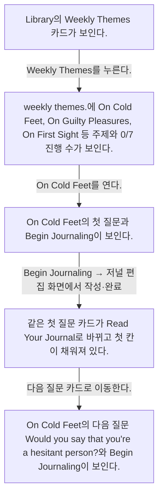

# Weekly themes from Library

- Mobbin 상세 페이지: https://mobbin.com/flows/de495541-d764-4118-a7b8-ab6d7a308590?tab=screens
- 앱·기기: stoic. iOS, 393×852
- 화면 수: 상세 페이지 5장 / 저장 이미지 5장 / 아래 설명 5개
- 검증 상태: **verified** — 목록·상세 제목·URL과 이미지 5장의 순서를 대조했다. 화면 3→4 사이 `Begin Journaling` 후 일반 저널 작성과 같은 편집 화면에서 답변을 완료했다는 사용자 확인을 받았다. 중간 편집 화면은 이 상세 페이지에 없다.

## 화면별 기록

1.  Library의 `Weekly Themes` 카드가 보인다. `Weekly Themes`를 누른다. 다음 화면에서는 `weekly themes.`에 On Cold Feet, On Guilty Pleasures, On First Sight 등 주제와 0/7 진행 수가 보인다.
2.  `weekly themes.`에 On Cold Feet, On Guilty Pleasures, On First Sight 등 주제와 0/7 진행 수가 보인다. On Cold Feet를 연다. 다음 화면에서는 On Cold Feet의 첫 질문과 `Begin Journaling`이 보인다.
3.  On Cold Feet의 첫 질문과 `Begin Journaling`이 보인다. `Begin Journaling`을 누른 뒤 [Logging a journal entry](../logging-a-journal-entry-e2e1f9b5/README.md)와 같은 저널 편집 화면에서 답변을 작성·완료한다(사용자 확인). 중간 편집 화면은 이 상세 페이지에 없다. 다음 화면에서는 같은 첫 질문 카드가 `Read Your Journal`로 바뀌고 첫 칸이 채워져 있다.
4.  같은 첫 질문 카드가 `Read Your Journal`로 바뀌고 첫 칸이 채워져 있다. 다음 질문 카드로 이동한다. 다음 화면에서는 On Cold Feet의 다음 질문 `Would you say that you're a hesitant person?`와 `Begin Journaling`이 보인다.
5.  On Cold Feet의 다음 질문 `Would you say that you're a hesitant person?`와 `Begin Journaling`이 보인다.

## BMad handoff notes

- **관찰된 진입 상태:** Library의 Weekly Themes 카드.
- **주요 행동:** On Cold Feet 첫 질문에서 저널을 작성·완료하고 다음 질문 카드를 탐색한다. 이 상세 페이지에는 편집 화면이 없다.
- **기대 결과:** 첫 질문은 Read Your Journal 상태가 되고 다음 질문이 표시된다.
- **되돌릴 수 있거나 파괴적인 동작:** 작성된 저널을 읽을 수 있다. 수정·삭제 경로는 화면에서 확인 불가.
