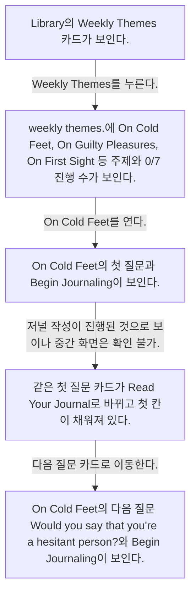
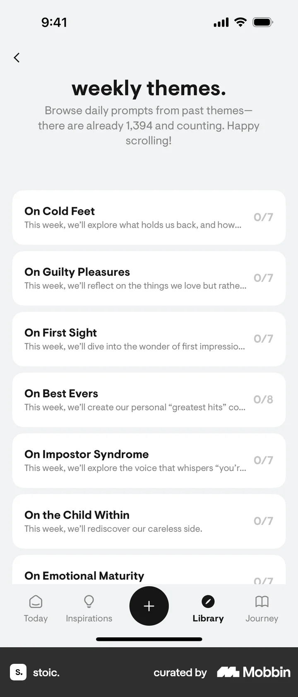
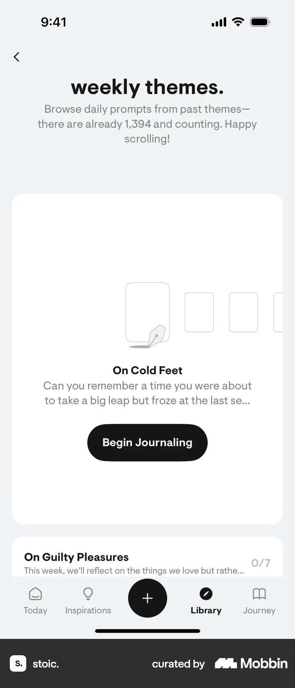
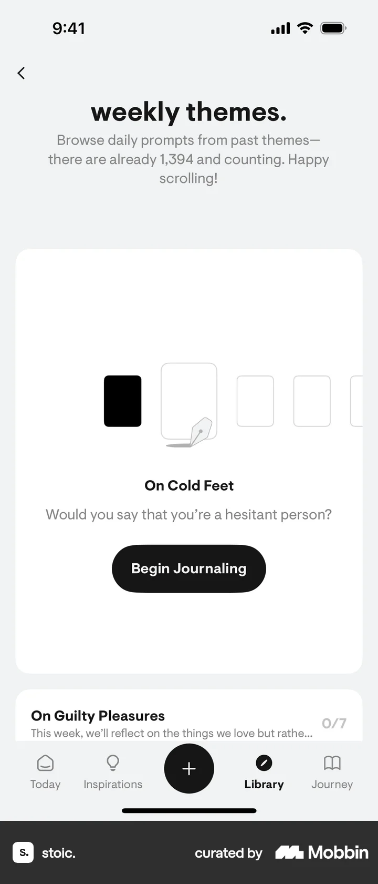

# Weekly themes from Library

- Mobbin 상세 페이지: https://mobbin.com/flows/de495541-d764-4118-a7b8-ab6d7a308590?tab=screens
- 앱·기기: stoic. iOS, 393×852
- 화면 수: 상세 페이지 5장 / 저장 이미지 5장 / 아래 설명 5개
- 검증 상태: **blocked** — On Cold Feet 질문이 시작 전에서 완료 상태로 바뀌는 사이 실제 저널 작성 화면이 없다.

## 화면별 기록

1.  Library의 `Weekly Themes` 카드가 보인다. `Weekly Themes`를 누른다. 다음 화면에서는 `weekly themes.`에 On Cold Feet, On Guilty Pleasures, On First Sight 등 주제와 0/7 진행 수가 보인다.
2.  `weekly themes.`에 On Cold Feet, On Guilty Pleasures, On First Sight 등 주제와 0/7 진행 수가 보인다. On Cold Feet를 연다. 다음 화면에서는 On Cold Feet의 첫 질문과 `Begin Journaling`이 보인다.
3.  On Cold Feet의 첫 질문과 `Begin Journaling`이 보인다. 저널 작성이 진행된 것으로 보이나 중간 화면은 확인 불가. 다음 화면에서는 같은 첫 질문 카드가 `Read Your Journal`로 바뀌고 첫 칸이 채워져 있다.
4.  같은 첫 질문 카드가 `Read Your Journal`로 바뀌고 첫 칸이 채워져 있다. 다음 질문 카드로 이동한다. 다음 화면에서는 On Cold Feet의 다음 질문 `Would you say that you're a hesitant person?`와 `Begin Journaling`이 보인다.
5.  On Cold Feet의 다음 질문 `Would you say that you're a hesitant person?`와 `Begin Journaling`이 보인다.

## BMad handoff notes

- **관찰된 진입 상태:** Library의 Weekly Themes 카드.
- **주요 행동:** 주제를 열고 On Cold Feet 질문 카드들을 탐색한다. 첫 저널 작성 과정은 화면에서 확인 불가.
- **기대 결과:** 첫 질문은 Read Your Journal 상태가 되고 다음 질문이 표시된다.
- **되돌릴 수 있거나 파괴적인 동작:** 작성된 저널을 읽을 수 있다. 수정·삭제 경로는 화면에서 확인 불가.
